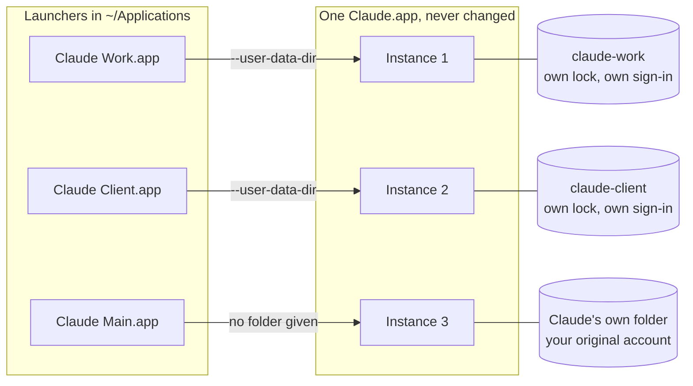

# aidentity guide

This is the full user guide for `aidentity`, a command-line tool that runs several accounts of the same Mac app at once, for apps built on Chromium or Electron. It describes version 1.2.0.

**On this page:** [Quick start](#quick-start) · [Install and upgrade](#install-and-upgrade) · [The problem](#the-problem) · [Which apps work](#which-apps-work) · [How it works](#how-it-works) · [Is this safe?](#is-this-safe) · [Signing in to a new profile](#signing-in-to-a-new-profile) · [Opening your original account](#opening-your-original-account-while-a-profile-runs) · [Dock tiles](#the-rough-edge-dock-tiles-show-the-original-app) · [Commands](#commands) · [Per-profile settings](#per-profile-settings) · [FAQ](#frequently-asked) · [Uninstall](#uninstall) · [Requirements](#requirements) · [Contributing](#contributing)

**Run several accounts of the same Chromium or Electron Mac app at the same time. Each one stays signed in, in its own window.**

macOS runs an app only once, so you get one account at a time. To check your personal Claude, you sign out of your work Claude. `aidentity` gives each extra account a small launcher and its own data folder. Together they make a *profile*. Your work, personal and client accounts then open side by side.

- **Verified with** Claude Desktop and ChatGPT. It should also work with Slack, VS Code and other apps built on Chromium (the engine inside Google Chrome) or Electron. See [Which apps work](#which-apps-work).
- **Your real app is not changed.** It is never copied, patched or re-signed. See [Is this safe?](#is-this-safe)
- **One shell script** (a text file of Terminal commands). Once installed, it makes no network calls, never uses `sudo` (admin rights) and runs nothing in the background.
- **Set up once in Terminal.** After that, you open each account by clicking its icon, like any other app.

---

<a id="30-seconds"></a>

## Quick start

You need a Mac and the Terminal app. To open Terminal, press **Cmd + Space**, type `Terminal` and press **Return**.

**1. Install.** Paste this line into Terminal and press **Return**:

```bash
curl -fsSL https://raw.githubusercontent.com/PiniShv/aidentity/main/install.sh | bash
```

This puts one file, the `aidentity` command, on your Mac. It checks the download first. It never uses `sudo` (admin rights), it does not edit your shell settings, and it starts nothing in the background. Want to read it first, or use Homebrew? See [Install and upgrade](#install-and-upgrade).

**2. Say yes to the walkthrough.** The installer ends with `Set up your first extra account now? [Y/n]`. Press **Return**.

**3. Answer the questions.** For each yes/no question, press **Return** to take the suggested answer. Pick your app from the numbered list. Type a name for the account, for example `Work`. When it asks `Set up another account?` and you are done, type `n`.

**4. Open the new icon and sign in.** The walkthrough offers to open the `Applications` folder in your home folder. Double-click the new icon, for example `Claude Work`. It opens signed out. Sign in with your second account. You do this only once. Drag the icon to your Dock to keep it one click away.

> [!IMPORTANT]
> If the app is already open, quit it before you sign in to the new icon. Open your other window again afterwards. Some apps sign you in through your web browser, and macOS sends that sign-in back to the app window that started first. [More on this](#signing-in-to-a-new-profile).

That is it. Each window now keeps its own sign-in.

Not sure your app will work? This lists the apps on your Mac that can take extra accounts:

```bash
aidentity apps
```

### What it looks like


<sub>The recording uses the direct commands from [Commands](#commands). `aidentity setup` does only the first part, creating profiles, and it asks you questions instead.</sub>

### What next?

| I want to... | Go to |
|---|---|
| Add another account, in this app or another one | [`aidentity add`](#aidentity-add) |
| Open my original account while another one runs | [Opening your original account](#opening-your-original-account-while-a-profile-runs) |
| Tell the running windows apart | [The rough edge: Dock tiles](#the-rough-edge-dock-tiles-show-the-original-app) |
| Change a name or a colour | [`aidentity rename`](#aidentity-rename), [`aidentity set`](#aidentity-set) |
| Bring back an icon I deleted | [`aidentity restore`](#aidentity-restore) |
| Fix something that looks wrong | [`aidentity doctor`](#aidentity-doctor) |
| Remove one account, or everything | [`aidentity rm`](#aidentity-rm), [Uninstall](#uninstall) |

---

## Install and upgrade

This page describes version 1.2.0. You need macOS and the `bash` that comes with it. See [Requirements](#requirements).

**Install script (recommended).** This is the line from the quick start. It installs into `/usr/local/bin`, or into `~/.local/bin` if it cannot write there. Terminal finds commands only in the folders on your `PATH` (a list of folders). If the new folder is not on it, the installer prints the line to add and leaves your shell files alone. It installs a fixed, numbered version (a release tag), not the newest code on `main`. At the end it offers to start the walkthrough.

<details>
<summary>Read the install script before you run it</summary>

```bash
curl -fsSLO https://raw.githubusercontent.com/PiniShv/aidentity/main/install.sh
```

```bash
less install.sh
```

```bash
bash install.sh
```

</details>

**Homebrew.** This uses a third-party tap (an extra package list that this project keeps), not homebrew-core, Homebrew's main list. `brew tap pinishv/tap && brew install aidentity` does the same in two steps.

```bash
brew install pinishv/tap/aidentity
```

Homebrew does not start the walkthrough, so run it yourself:

```bash
aidentity setup
```

Homebrew installs the latest release in the tap. Run `aidentity version` to see which one you have. Before 1.2.0, `restore`, `--main`, `--arg`, `--env`, `--own-extensions` and `doctor --fix` did not exist, so upgrade if you see an older version.

<details>
<summary>Install from source</summary>

```bash
git clone https://github.com/PiniShv/aidentity.git
```

```bash
cd aidentity && make install
```

This copies the same single script to `/usr/local/bin`. If that folder is not writable, `make install` prints your options, for example `make install PREFIX=$HOME/.local`. It never runs `sudo` itself.

</details>

**Upgrade.** `aidentity` never checks for updates by itself. Upgrade when you choose to. With Homebrew:

```bash
brew update && brew upgrade aidentity
```

With the install script, run the install line again. It replaces the old version. Launchers you built earlier keep working. `aidentity doctor` lists older ones, and `aidentity doctor --fix` brings them up to date.

To see what each way checks, read [What each install channel checks](#what-each-install-channel-checks).

---

## The problem

You have a work account and a personal account in the same app. Maybe a client account too. macOS runs that app only once, and the app remembers one signed-in session. To use the other account, you sign out and sign in again. You lose your open chats and your window layout. An hour later you do it all again the other way.

`aidentity` is for when you want the accounts open at once. Two or three windows sit side by side, and none of them signs the others out.

| Option | Good when | Downside |
|---|---|---|
| Sign out, sign in | You switch rarely. | One account at a time. You repeat the sign-in at every switch. |
| The app's own account switcher | The app has one, and one account at a time is enough. | Many apps have none. It is still one account at a time. |
| A browser profile with the web app | The web version is enough. | You get the web app, not the desktop app. |
| A copy of the app, signed again | Rarely. People try it to give the Dock tile a different name and icon. | A signature made on your Mac cannot match the maker's signature. The copy loses access to the keychain (where macOS keeps saved passwords and keys) and often will not start. |
| Typing the launch command yourself | You need it once. | It is the same mechanism, but you manage the folders, names and icons by hand. |
| **aidentity** | You want several accounts open at once. | macOS only. Chromium and Electron apps only. Running profiles share the app's Dock tile. |

Browsers such as Chrome and Edge have good built-in profiles. Use those first.

---

## Which apps work

An app can take extra accounts if it is built on **Chromium** or **Electron**. Chromium is the engine inside Google Chrome. Electron is a toolkit that builds desktop apps on that engine. `aidentity apps` shows which of your apps qualify.

| App | Works | Notes |
|---|---|---|
| Claude Desktop | Verified | `com.anthropic.claudefordesktop`. Use `--seed` to copy your MCP server config into the new profile. |
| ChatGPT | Verified | `com.openai.codex`. It looks native, but it is Chromium inside. |
| Slack | Detected | Slack's own workspace switcher covers most cases. Profiles are for separate *accounts*. |
| Visual Studio Code | Detected | Separate profiles get separate settings. Extensions are shared unless you use [`--own-extensions`](#per-profile-settings). |
| Cursor | Detected | A fork of VS Code, so the same applies. |
| Notion | Detected | |
| Notion Calendar | Detected | |
| Postman | Detected | |
| Microsoft Teams (classic) | Detected | The classic Electron build only. |
| Google Chrome | Detected | Chrome has built-in profiles. Use those first. |
| Microsoft Edge | Detected | Built-in profiles are the better tool here too. |
| Brave / Arc / Vivaldi / Comet | Detected | Browsers. Built-in profiles usually do the job better. |
| Antigravity | Detected | |
| Kiro | Detected | |
| Podman Desktop | Detected | |
| ChatGPT Classic | **No** | `com.openai.chat`. A native Swift app. See below. |

**Verified** means it was checked by hand, with two accounts signed in at once. **Detected** means the app has the Chromium or Electron structure that `aidentity` looks for, so the mechanism applies. Nobody has signed in to it twice by hand yet. If one of them misbehaves, [open an issue](https://github.com/PiniShv/aidentity/issues) and the table gets fixed.

There is no list of apps in the code. `aidentity` looks at how each app is built: it looks for `Electron Framework.framework`, or for a framework with Chromium helper apps inside. `apps` and `setup` look in `/Applications` and `~/Applications`. For an app somewhere else, give `add` the path to the `.app`.

### Genuinely native apps do not work

Apps written in Swift or AppKit have no `--user-data-dir` option, because they have no Chromium inside to accept it. Without that option, `aidentity` has nothing to work with. **ChatGPT Classic** (`com.openai.chat`) is the example you are most likely to meet. The newer ChatGPT desktop app is Chromium and works. The Classic one is native and does not.

`aidentity add` checks this first, refuses and explains why. It does not build a launcher that would quietly open a second window on the same account. Support for native apps is not planned for version 1.

---

## How it works

Chromium and Electron apps keep a lock inside their own data folder. The lock stops the app from starting a second time. A start-up option, `--user-data-dir`, tells the app to use a different data folder. With a different folder, the app never sees the first lock, so it simply starts. Each start is a separate *instance*: the same app, running again on its own. Nothing on disk is copied. Cookies and sign-in data live in that data folder, so each folder keeps its own account.

`aidentity` builds a **profile** for each extra account: a small launcher app and its own data folder. The launcher opens the app you already have, with that folder.



The launcher is a short shell script inside a small `.app` folder. Here it is, shortened. The real file has the code for the first two comments. You can read yours with `cat`, or in Finder with **Show Package Contents**.

```sh
#!/bin/sh
# Generated by aidentity 1.2.0. Safe to delete.
# 1. Drop risky variables (DYLD_*, LD_*, ELECTRON_*, NODE_*, ...) from the environment.
# 2. On a new profile's first open, warn if another instance of the app is already running.
# 3. Open the app again, with this profile's folder:
exec /usr/bin/env "$@" /usr/bin/open -na '/Applications/Claude.app' \
  --args --user-data-dir='/Users/you/Library/Application Support/aidentity/profiles/claude-work'
```

That `open -na` line is the whole mechanism. A launcher for your original account, made with `--main`, is the same line without `--user-data-dir`. The launcher holds the path to your app, not a copy of it. So when the app updates, the next launch uses the new version.

**Where things live** (defaults):

| What | Path |
|---|---|
| Launcher | `~/Applications/<App> <Profile>.app` |
| Data folder | `~/Library/Application Support/aidentity/profiles/<slug>/` |
| Restore record | `<data folder>/.aidentity-profile.plist` |

The slug is the launcher name in lower case, with spaces and underscores turned into hyphens. Other characters are dropped. `Claude Work` gets the folder `claude-work`. The restore record stores the profile's name, app, badge, colour and launch settings, so a lost launcher can be [restored](#aidentity-restore). The app ignores it.

By default, each launcher shows the app's own icon with a coloured circle and one letter. The letter and colour come from the name, so a profile always looks the same. The launcher has no Dock tile of its own.

---

## Is this safe?

`aidentity` is one shell script, about 2,700 lines of bash. It runs as you, with your own permissions. [Read it](../bin/aidentity) before you run it.

### What it touches

| What | What aidentity does | How to undo it |
|---|---|---|
| The `aidentity` command | Puts one file on your Mac: in `/usr/local/bin` or `~/.local/bin` with the install script, or where Homebrew keeps its commands. | [Uninstall](#uninstall) |
| One launcher per profile | Builds a small app in `~/Applications`, for example `Claude Work.app`. It holds a script, an `Info.plist` with an `AIdentityProfile` marker, and an icon. It tells macOS about the new app so the icon shows at once. | `aidentity rm "Claude Work"` |
| One data folder per profile | Makes a folder under `~/Library/Application Support/aidentity/profiles/` that only you can open. The app keeps that account's sign-in there. `aidentity` adds one small restore record. | `aidentity rm "Claude Work" --purge`, or `aidentity prune` |
| Your real app | Read only. It looks at the app's `Info.plist`, its icon and its files, to check that it is a Chromium or Electron app. | Nothing to undo |
| Your original account | Never moved or changed. One exception: `--seed` reads Claude Desktop's `claude_desktop_config.json` and copies it into the new profile. | Nothing to undo |

One thing does change. While a profile is running, clicking the app itself switches to that profile. A Main launcher fixes this. See [Opening your original account](#opening-your-original-account-while-a-profile-runs).

### What it never does

- **Copy, patch or re-sign your app.** The app keeps its original signature, so its keychain access and its own updater keep working.
- **Touch a launcher it did not build.** Every launcher carries the `AIdentityProfile` marker. `open`, `rm`, `rename`, `set` and `rebuild` refuse an app without it. `add` and `restore` refuse to overwrite one.
- **Delete profile data outside its profiles folder.** `--purge`, `prune` and the uninstaller delete a data folder only if it is inside `~/Library/Application Support/aidentity/profiles`, or the folder set by `AIDENTITY_DATA_ROOT`.
- **Delete or rename a profile's data while the profile is running.** If it cannot tell, it treats the profile as running and stops.
- **Use the network.** No update check, no telemetry, no crash reports. Only the installer downloads anything.
- **Use `sudo` or run in the background.** It adds no login item, no launch agent and no daemon. These are ways macOS starts a program by itself, at login or in the background. When the installer or uninstaller needs admin rights, they print a `sudo` line for you to run.
- **Edit your shell files.** If you need a `PATH` line, the installer prints it, and you add it.
- **Control other apps.** It does not use System Events, so it needs no Accessibility permission.
- **Handle your passwords.** You sign in inside the app, with that account's own details.

<details>
<summary>More guards in the code</summary>

| Guard | What it does |
|---|---|
| Safe rebuilds | A new launcher is built beside the old one, then swapped in. If that fails or you press Ctrl+C, the old one comes back. A failed `rename` moves the data back. |
| Owner-only files | New data folders, restore records, seeded config files and launchers with settings can be read only by you. `doctor` reports folders that other users can read. |
| Allowlist for settings | `--arg` and `--env` accept only a short list of switches and variables, each with a strict value shape. The check runs again on every build. |
| Clean start | Before it opens the app, the launcher drops `DYLD_*`, `LD_*`, `ELECTRON_*`, `NODE_*`, `VSCODE_*`, `CHROME_*`, `CHROMIUM_*` and `SSLKEYLOGFILE`. |
| Safe names | Profile names allow only ASCII letters, digits, spaces, hyphens and underscores. Every value in the launcher is quoted. The `Info.plist` must pass `plutil -lint`. |
| Restore record is checked | `restore` checks the record as if you had typed it: the name, the folder, the app and the settings. |
| Asks first | `rm` and `prune` ask you to type `yes` (`-y` skips this). The uninstaller asks you to type `delete`. |

</details>

### Check it yourself

In a clone of the repository, look for network tools and `sudo`:

```bash
grep -nwE 'curl|wget|nc|ncat|ssh|scp|sudo|telnet' bin/aidentity
```

This should print only one line: a code comment about the installer.

Check the script against its checksum (a fingerprint of the file):

```bash
shasum -a 256 -c SHA256SUMS
```

To check the file you installed, run this:

```bash
shasum -a 256 "$(command -v aidentity)"
```

Compare the long number it prints with the `bin/aidentity` line in `SHA256SUMS` for your version. For 1.2.0, that file is at <https://raw.githubusercontent.com/PiniShv/aidentity/v1.2.0/SHA256SUMS>. For another version, change `v1.2.0` in the address.

Get a report of your setup. It changes nothing unless you add `--fix`:

```bash
aidentity doctor
```

### What each install channel checks

| Channel | What it checks | What it does not protect against |
|---|---|---|
| Install script | The download is complete and matches its checksum. See the list below. | A hacked repository, because the checksum comes from the same place. |
| Homebrew | The formula pins the SHA-256 checksum of the release. Homebrew refuses a download that does not match. | It is a third-party tap, so you trust its owner. This is stronger than the install script. |
| From source | You read what you build. `make install` copies one file. | Only what you skip reading. |

The install script checks the download like this:

- It uses HTTPS only.
- The file must look like a complete script. It must start with `#!`, have a version line, pass `bash -n` (a syntax check) and end on the expected last line.
- It compares the file's SHA-256 checksum with `SHA256SUMS` from the same release tag. If they do not match, it refuses to install.
- If no checksum exists for the tag, or `shasum` fails, it warns and continues with the other checks.

So it catches a cut-off or damaged download.

`SHA256SUMS` lists only `bin/aidentity`. The installer and uninstaller have no checksum, so read them first if that matters to you.

### What is not protected

- **Profile data is not encrypted by `aidentity`.** Each data folder holds live sign-in cookies and tokens, just like the app's own folder. Your file permissions and FileVault (Apple's disk encryption) protect them, and nothing else. A second profile is a second live session on your disk.
- **The launcher is not notarised.** Notarisation is Apple's check of software from a developer. Your launcher is built on your Mac. It gets a local signature if the Xcode Command Line Tools are installed, and none if they are not. It runs either way.
- **Only the latest release gets fixes.** There are no fixes for older versions.

To report a security problem privately, follow [SECURITY.md](../SECURITY.md). Please do not open a public issue for it.

---

## Signing in to a new profile

Some apps sign you in through your web browser. After you approve, the browser passes the result back to the app as a link. When several instances of one app run, macOS gives that link to the instance that started **first**. So if you sign in to a new profile while another instance is open, the sign-in can land in the wrong window.

To protect you, a new profile's launcher shows a warning when you open it for the first time while another instance of the app runs. Choose **Open Anyway** to go on, or **Cancel** to stop. If you cancel, it warns you again next time.

The safe order is:

1. Quit the other windows of that app.
2. Open the new profile and sign in.
3. Open the other windows again.

After that first sign-in, each profile stays signed in on its own. `add` and `setup` print the same advice when the app is already open.

---

## Opening your original account while a profile runs

macOS keeps one record per app, not one per window. Every profile is the same `Claude.app`, started again. So while any profile runs, macOS thinks Claude is running. If you click `Claude.app` in the Dock, in Finder or in Spotlight, macOS switches to the running app. You land in whichever profile is open, and your original account does not start.

The fix is a launcher for your original account. The walkthrough offers one after your first profile in an app. You can also build it yourself:

```bash
aidentity add Claude --main
```

This builds `~/Applications/Claude Main.app`. It starts Claude with no profile folder, so it opens the account that `Claude.app` always opened, with Claude's own data. It starts even while other profiles run. If your original account is already open, Claude passes the launch on to that open window. Pin it to your Dock instead of `Claude.app`.

From Terminal, `open -na /Applications/Claude.app` does the same thing.

A Main launcher never touches the app's data. `rm --purge` does not delete it, and `rename` only renames the launcher. Each app can have one Main launcher.

---

## The rough edge: Dock tiles show the original app

This is the biggest cost. Know it before you start.

The launcher icon carries your profile's name and a coloured letter badge. That is what you see in Finder, and what you drag to the Dock. But while the app runs, the Dock shows the app's own tile. Its name and icon come from inside the app, and `aidentity` does not change the app. So two running Claude profiles both show a tile named "Claude", with Claude's icon.

How to tell them apart:

- **Look at the window.** Most of these apps show the signed-in account in the sidebar, the title bar or an avatar.
- **Give each profile a different badge colour.** The launcher icons in Finder, and the ones you pin to the Dock, stay different. So you always open the right one.
- **Use Mission Control** (swipe up, or press `Ctrl` + `Up`). It shows all windows at once, with their content.
- **Run `aidentity list`.** It shows which profiles are running.

Changing the tile would mean copying the app and signing it again. That does not work. A copy signed on your Mac cannot match the maker's signature, so it loses keychain access and often will not start. Renaming a running instance from outside the app does not work either, because macOS ignores the change. So `aidentity` leaves your app alone and accepts an unclear Dock label.

---

## Commands

Type `aidentity` and a command. Put a name that has a space in quotes, like `"Claude Work"`. Type `aidentity` on its own to see the built-in help. The output is plain text for people. There is no JSON output. Colour is off when the output is not a terminal, or when `NO_COLOR` is set.

| Command | Also spelled | What it does |
|---|---|---|
| [`setup`](#aidentity-setup) | `init`, `wizard` | Guided walkthrough. Start here. |
| [`add [app]`](#aidentity-add) | | Create one profile directly. |
| [`list`](#aidentity-list) | `ls` | Show every profile and whether it is running. |
| [`open NAME`](#aidentity-open) | | Open a profile from Terminal. |
| [`rename OLD NEW`](#aidentity-rename) | `mv` | Rename a profile. It stays signed in. |
| [`set NAME`](#aidentity-set) | `modify`, `edit` | Change a profile's look or launch settings. |
| [`prune`](#aidentity-prune) | | Find data that no launcher uses, and offer to delete it. |
| [`restore [NAME]`](#aidentity-restore) | | Bring back a launcher that was deleted. |
| [`rebuild NAME`](#aidentity-rebuild) | `repair` | Rebuild launchers after an app moved or updated. |
| [`rm NAME`](#aidentity-rm) | `remove`, `delete` | Remove a launcher. The data stays unless you add `--purge`. |
| [`apps`](#aidentity-apps) | | List apps that can take extra accounts. |
| [`doctor`](#aidentity-doctor) | | Check the setup and every profile. `--fix` repairs what it can. |
| [`version`, `help`](#aidentity-version--aidentity-help) | `--version`, `-v`, `--help`, `-h` | Print the version, or the help. |

### `aidentity setup`

The guided walkthrough, and the best place to start.

```bash
aidentity setup
```

It asks, in this order:

1. Whether to add a coloured badge to each icon, so you can tell them apart. The default is yes.
2. Which app needs another account. You pick from a numbered list. Type `q` to stop.
3. What to call the account, for example `Work`, `Personal` or `Client`.
4. For Claude Desktop only, and only if it finds your config file: whether to copy your MCP server config (the extra tools you connected to Claude) into the new profile.
5. After your first profile in an app: whether to add a `Main` launcher for your original account.
6. Whether to set up another account.

At the end it offers to open `~/Applications`, so you can drag the new icons to your Dock. If one profile fails, the walkthrough says so and continues.

It needs a terminal. In a script, use `add` with its options instead.

### `aidentity add`

Create one profile directly.

```bash
aidentity add                                                         # asks for the app and the name
aidentity add Claude --profile Work --color blue --seed               # no questions
aidentity add ChatGPT --profile Personal
aidentity add "/Applications/Visual Studio Code.app" --profile Client # an app given by its path
```

The app can be a name or a path. Names are not case-sensitive. Without an app or a `--profile`, `add` asks for them, so it needs a terminal.

| Option | What it does |
|---|---|
| `--profile NAME` | The account name, for example `Work`. Up to 40 characters: ASCII letters, digits, spaces, `-` and `_`. It cannot start or end with a space, and it cannot start with `-`. |
| `--badge X` | One character for the icon badge. Default: the first letter of the name. |
| `--color NAME` | `blue` `green` `orange` `purple` `teal` `pink` `red` `yellow` `gray` `graphite` (`grey` and `black` also work), or six hex digits such as `2E7DF6`, without `#`. Default: a colour picked from the name, so a profile always looks the same. |
| `--no-badge` | Use the app's own icon, unchanged, with your profile's name. |
| `--seed` | Claude Desktop only. Copy your `claude_desktop_config.json` (your MCP servers) into the new profile. After that, the two configs are separate. |
| `--main` | Build a launcher for your **original** account instead. It is named `<App> Main` unless you pass `--profile`. See [Opening your original account](#opening-your-original-account-while-a-profile-runs). |
| `--arg SWITCH` | Pass a start-up option (a *switch*) to the app every time. Repeat it for more. See [Per-profile settings](#per-profile-settings). |
| `--env NAME=VALUE` | Set an environment variable for this profile. Repeat it for more. |
| `--own-extensions` | VS Code and its forks only, such as Cursor and Kiro. Give the profile its own extensions folder. |

The launcher is named `<App> <Profile>`. For example, `aidentity add Claude --profile Work` makes `~/Applications/Claude Work.app`. That full name is what you give to `open`, `rename`, `set`, `rebuild`, `restore` and `rm`.

- Names that would share one data folder are refused. `Work 2`, `Work_2` and `Work-2` all clash.
- Run `add` again for a profile that exists, and it rebuilds the launcher. It keeps the badge, colour and settings unless you give new ones. It does not touch the data.
- `add` refuses while that profile is running.
- It refuses to overwrite anything at that path that `aidentity` did not create.

### `aidentity list`

Shows every profile, its app, where its data lives and whether it is running.

```bash
aidentity list
```

```text
Claude Work
   app      Claude
   profile  Work
   status   running
   data     /Users/you/Library/Application Support/aidentity/profiles/claude-work
```

The status is one of these:

- `running`: the profile is open now.
- `in use`: the profile has been opened before, but is not open now. This does not prove that the sign-in is still valid.
- `signed out / new`: the app has not saved anything in the profile yet.
- `running` or `not running`, for a Main launcher.
- `app missing`: the app has moved or is gone. The line shows the `rebuild` command that fixes it. If the app was uninstalled, reinstall it first.

`list` shows launch switches in full, and the *names* of variables, never their values.

### `aidentity open`

Opens a profile from Terminal, instead of double-clicking it in Finder.

```bash
aidentity open "Claude Work"
```

### `aidentity rename`

Renames a profile. Its data moves with it, so the account stays signed in.

```bash
aidentity rename "Claude Work" Client
```

The second name is the new *account* name. The app name stays first. This example makes `~/Applications/Claude Client.app` and moves the data to `.../profiles/claude-client`. The data moves first and the launcher is rebuilt second. If the rebuild fails, or you interrupt it, the data moves back. A badge you picked by hand stays. A default badge follows the new name.

`rename` refuses while the profile is running, and when the new name is already taken.

### `aidentity set`

Changes a profile's badge, colour or launch settings, without touching its sign-in.

```bash
aidentity set "Claude Work" --color purple
aidentity set "Claude Work" --badge W
aidentity set "Claude Work" --no-badge
```

- `--color`, `--badge`, `--no-badge`, `--arg`, `--env` and `--own-extensions` take the same values as on `add`.
- `--clear-args` undoes `--arg`, `--clear-env` undoes `--env`, and `--shared-extensions` undoes `--own-extensions`.
- You must give at least one option.
- Only the launcher and its restore record are rewritten. The app's own data is never opened, so this is safe while the app runs.
- New launch settings apply the next time the profile opens.
- Asking for a colour on a launcher with no badge adds a badge back.

### `aidentity prune`

Finds profile data that no launcher points at, and offers to delete it.

```bash
aidentity prune
```

This data is left behind when you delete a launcher in Finder, or run `rm` without `--purge`. The folder stays, and it still holds a signed-in session. `prune` lists each folder with its size and full path, and marks the ones `restore` can bring back. Then it asks you to type `yes`. `-y` or `--yes` skips the question. It skips anything that is running.

Before it calls a folder an orphan, `prune` looks for launchers in your launcher folder, in the app folders and through Spotlight. If you keep a launcher somewhere else, its data shows up in the list. Read the list before you type `yes`.

### `aidentity restore`

Rebuilds the launcher of a profile whose launcher is gone. The account opens again, still signed in.

```bash
aidentity restore                  # list what can be restored
aidentity restore "Claude Work"    # restore one
aidentity restore --all            # restore all of them
```

- `restore` reads the restore record in the data folder.
- If the app moved, it finds it again: first by name, then by bundle ID (the name macOS uses for an app, such as `com.anthropic.claudefordesktop`).
- It builds the launcher with the same look and settings. It checks everything in the record as if you had typed it.
- Profiles made before version 1.2.0 have no record yet. They get one the next time their launcher is rebuilt, and `aidentity doctor --fix` does that for you.
- A profile removed with `--purge` cannot be restored.

### `aidentity rebuild`

Rebuilds launchers, for example after the app moved.

```bash
aidentity rebuild "Claude Work"    # one profile
aidentity rebuild --all            # every profile
```

- A launcher stores the path of its app. If that path is gone, `rebuild` looks the app up again by name. This covers a move between `/Applications` and `~/Applications`.
- If it still cannot find the app, it reports that profile, skips it and exits with an error.
- It also brings launchers built by an older version up to date.
- A launcher built by version 1.0.0 gets the default badge and colour. A letter or colour you picked by hand is lost. Set it again with `aidentity set`.
- Profile data is never touched, so every account stays signed in.

### `aidentity rm`

Removes a launcher. The data is kept by default.

```bash
aidentity rm "Claude Work"
```

It then prints how to bring the profile back (`aidentity restore "Claude Work"`) and how to delete its data (`aidentity prune`). If it cannot write a restore record, it prints the matching `aidentity add` line instead.

To remove the launcher and delete the profile's data:

```bash
aidentity rm "Claude Work" --purge
```

> [!CAUTION]
> `--purge` deletes the account's cookies, sign-in and settings from this Mac. It cannot be undone, and `restore` cannot bring them back.

`rm` takes one name and asks you to type `yes`. Add `-y` or `--yes` to skip the question. It refuses while that profile is running. A Main launcher has no data of its own, so `rm` removes it even while the app runs. On a Main launcher, `--purge` does nothing, because `aidentity` never deletes the app's own data.

### `aidentity apps`

Lists the apps in `/Applications` and `~/Applications` that can take extra accounts, with their bundle IDs (the name macOS uses for an app).

```bash
aidentity apps
```

### `aidentity doctor`

Checks the setup, then every profile. Run it first when something looks wrong. If you report a bug, paste its output.

```bash
aidentity doctor
```

The output shows your Mac user name (inside folder paths) and the name of every profile. Before you paste it into a public issue, remove anything you want to keep private.

At the top it shows your macOS version, the `aidentity` version and the bash version. It shows whether the launcher folder can be written to. The `codesign` row shows whether the Xcode Command Line Tools are installed. It also counts the compatible apps and the profiles. Then it prints a tick for each healthy profile and one line for each problem. It reports:

- a launcher built by an older version, or one with its script or restore record missing
- an app that moved, is gone, or no longer looks like Chromium or Electron
- a data folder that is missing, outside the profiles folder, shared with another launcher, or readable by other users
- data folders with no launcher

The last line counts the problems, and says how many `--fix` can repair.

```bash
aidentity doctor --fix
```

`--fix` repairs what needs no decision from you. It rebuilds out-of-date launchers, which also writes missing restore records. It makes data folders readable by you only. It never reads or changes the account data inside a folder. Problems that need your decision stay on the list, such as a deleted app.

`doctor` always exits with success, so a script can read its report. `doctor --fix` exits with an error if something it tried to fix could not be fixed.

### `aidentity version` / `aidentity help`

```bash
aidentity version
aidentity help
```

`aidentity --version` and `aidentity -v` also print the version. `aidentity --help`, `aidentity -h` and `aidentity` on its own show the help. An unknown command prints the help and exits with an error.

### Environment variables

An environment variable is a named setting you put in front of a command. You do not need any of these for normal use.

| Variable | Used by | Default and effect |
|---|---|---|
| `AIDENTITY_APP_DIRS` | `aidentity`, uninstaller | `/Applications:$HOME/Applications`. Colon-separated folders searched for compatible apps. The uninstaller looks here for launchers. |
| `AIDENTITY_APPS_DIR` | `aidentity`, uninstaller | `~/Applications`. Where launchers are written, and where the uninstaller looks for them. |
| `AIDENTITY_DATA_ROOT` | `aidentity`, uninstaller | `~/Library/Application Support/aidentity/profiles`. Where profile data lives. |
| `NO_COLOR` | `aidentity`, installer, uninstaller | Any non-empty value turns colour off. |
| `AIDENTITY_INSTALL_DIR` | installer, uninstaller | Install into this folder instead of `/usr/local/bin` or `~/.local/bin`. The uninstaller looks here for the command. |
| `AIDENTITY_REF` | installer | The branch, tag or commit to install. Default: the release tag named in the script. |
| `AIDENTITY_BIN_DIRS` | uninstaller | Colon-separated folders to look in for the command, instead of the usual places. |

`AIDENTITY_APP_DIRS` and `AIDENTITY_APPS_DIR` differ only by where the `S` sits, and they mean different things. `APP_DIRS` is where your *apps* are searched for. `APPS_DIR` is where `aidentity` *writes* its launchers.

---

## Per-profile settings

Most people never need this. A profile can carry a few launch settings of its own, such as a proxy for a client's network, a language or a display scale:

```bash
aidentity add Claude --profile Client --arg --proxy-server=socks5://127.0.0.1:1080
aidentity set "Claude Client" --arg --lang=de --env HTTPS_PROXY=http://proxy.example:8080
aidentity add "Visual Studio Code" --profile Client --own-extensions
```

Only an *allowlist* (a fixed list of what is permitted) gets through. A launcher is one click for anyone at your Mac. Many switches and variables can hand the app to another program, or switch off its protections.

| Setting | Accepted values |
|---|---|
| `--proxy-server`, `--proxy-bypass-list` | A proxy value: up to 512 characters from `A-Za-z0-9:/._;=*,<>@+-` |
| `--no-proxy-server`, `--disable-gpu`, `--disable-lcd-text` | No value |
| `--lang`, `--locale` | A language tag, like `de` or `pt-BR` |
| `--force-device-scale-factor` | A number from 0.5 to 4 |
| `HTTP_PROXY`, `HTTPS_PROXY`, `ALL_PROXY`, `NO_PROXY`, and the same names in lower case | A proxy value |
| `LANG`, `LC_ALL`, `LC_CTYPE`, `LC_MESSAGES` | A locale, like `de_DE.UTF-8` |
| `TZ` | A time zone, like `Europe/Berlin` |

Anything else is refused. The same check runs again on `rebuild`, `rename`, `restore`, `set` and `doctor --fix`. A stored setting that is no longer allowed is dropped with a note, and never passed on.

Settings are stored in the launcher and in the restore record. A launcher with settings can be read only by you, but it is still a plain file. **Do not put passwords in launch settings.** `aidentity list` prints switch values in full, so a proxy address with a password in it would show.

VS Code and its forks keep extensions outside the data folder, so by default every profile shares yours. `--own-extensions` gives the profile its own `extensions` folder inside its data folder. `aidentity` recognises VS Code and its forks, such as Cursor and Kiro, by their `product.json` file.

---

## Frequently asked

### Something went wrong. Where do I start?

Run `aidentity doctor`. It checks your setup and every profile, and prints what is wrong. If it says problems can be fixed, run `aidentity doctor --fix`.

Still stuck? [Open an issue](https://github.com/PiniShv/aidentity/issues) and paste the output of `aidentity doctor`. For a problem with one app, add the output of `aidentity apps`. These outputs can show your Mac user name, your profile names and your apps. Remove anything you want to keep private first.

### Terminal says `command not found: aidentity`

The installer put the command in a folder that Terminal does not search yet. The installer printed a line to add to your shell settings file. If you no longer have it, this is the line for the usual case: the command in `~/.local/bin`, and zsh, the Mac's default shell.

```bash
echo 'export PATH="$HOME/.local/bin:$PATH"' >> ~/.zshrc
```

Then open a new Terminal window, or reload the file:

```bash
source ~/.zshrc
```

For bash, use `~/.bash_profile` in place of `~/.zshrc`. For fish, run `fish_add_path ~/.local/bin` instead. Until then, you can run the command by its full path, for example `~/.local/bin/aidentity`.

### Can I use more than two accounts?

Yes. `aidentity` has no limit. Run `add` once per account. Each one gets its own folder and its own lock. Give each one a different colour, so the icons are easy to tell apart. The real limit is memory, because every running profile is its own instance of the app.

### Does it break auto-update?

No. Your app updates itself as it always did. It is still the same untouched app in `/Applications`, and `aidentity` does not touch its updates.

### Does aidentity update itself?

No. It has no update check and makes no network calls. See [Install and upgrade](#install-and-upgrade) for how to upgrade it.

### What happens when the app updates?

Nothing for you to do. A launcher stores the *path* to the app, not a copy, so the next launch uses the new version. The one case that needs help is when the app *moves*, for example when you reinstall it into `~/Applications` instead of `/Applications`. Then run `aidentity rebuild --all`.

### Does a new profile start signed in?

No. A new profile starts with an empty folder, so you sign in once with that account's own details. `aidentity` does not copy, move or read your existing sign-in. The one exception is `--seed`, which copies Claude Desktop's MCP server config.

### Why do both running Dock tiles show the same app name and icon?

The name and icon live inside the app, and `aidentity` does not change the app. Only the launcher carries your profile's name and badge. See [The rough edge](#the-rough-edge-dock-tiles-show-the-original-app) for how to tell the windows apart.

### What happens when I click a profile that is already open?

Its launcher starts the app again with the same folder. The app sees its own instance running and passes the click on to it. That window comes forward. If you had closed its window, it opens again.

### Clicking Claude.app opens one of my profiles, not my original account

macOS sees every profile as Claude itself, so it switches to whichever one is running. Use `aidentity add Claude --main`. See [Opening your original account](#opening-your-original-account-while-a-profile-runs).

### I deleted an icon by mistake

Run `aidentity restore`. It lists the profiles whose launcher is gone. Their data is still there, so the restored icon opens the same account, signed in. This does not work for a profile you removed with `--purge`.

If a profile you expect is not in the list, it may be older than version 1.2.0 and have no restore record. Run `aidentity add` again with the same app and the same account name. It uses the same folder again.

### Does it work with Claude Code or other command-line tools?

No, and it does not need to. `aidentity` works on desktop apps. Command-line tools keep their sign-in in other ways, and many have their own way to use several accounts.

One related point. Claude Desktop keeps its MCP server list inside the data folder, so a new profile starts with none. `--seed` copies your config across as a starting point. After that, the two are separate.

### Is this against the terms of service?

`aidentity` creates separate local data folders and passes a documented command-line option. It does not get around sign-in, share credentials, bypass licences or change the app. You still sign in to each account normally, with its own details. Terms differ by product and plan, and some limit how many devices or sessions one seat may use. Check the terms of the plans you use. This is not legal advice.

### Both accounts are on the same plan. Do I need two subscriptions?

That is between you and the vendor. It depends on whether you have two separate accounts, which usually pay separately, or one account used twice. `aidentity` does not change what you may use. It changes how many windows you can have open.

### How do I remove everything?

Use the uninstaller. See [Uninstall](#uninstall).

---

## Uninstall

`aidentity` has no uninstall command. The uninstaller script removes everything it made, in one go. It is a plain script, like the installer. Download it, [read it](../uninstall.sh) if you like, then run it in Terminal:

```bash
curl -fsSLO https://raw.githubusercontent.com/PiniShv/aidentity/main/uninstall.sh
```

```bash
bash uninstall.sh
```

What it does:

1. **Removes the command, without asking.** It looks in the usual install folders and wherever your `PATH` finds it. It leaves a Homebrew install and a repository checkout alone, and tells you so. If it cannot delete the file, it prints a `sudo rm -f` line for you to run. It never runs `sudo` itself.
2. **Lists everything else, with sizes.** That means every launcher that carries the marker, and every data folder, including data that no launcher points at any more.
3. **Stops if any listed profile is running.** Quit it, then run the script again.
4. **Deletes only after you type `delete`.** Any other answer keeps your launchers and data. They keep working without the command.

It removes launchers only if they carry the marker, and data only inside the profiles folder. For a Main launcher, it removes the launcher and keeps the app's own data. macOS keeps Dock tiles after an app is gone, so drag the old ones out yourself.

<details>
<summary>Remove everything by hand</summary>

Do these steps in order, one block at a time. Quit every profile first.

1. See what exists:

   ```bash
   aidentity list
   ```

2. Remove each launcher that `list` shows, Main launchers too. Run this once for each one, with its own name. `--purge` also deletes the profile's data:

   ```bash
   aidentity rm "Claude Work" --purge
   ```

3. Delete data that no launcher points at:

   ```bash
   aidentity prune
   ```

4. Remove the command. If you installed with Homebrew:

   ```bash
   brew uninstall aidentity
   ```

   If you installed with the script or with `make`:

   ```bash
   rm -f "$(command -v aidentity)"
   ```

5. Remove the empty data folders. `rmdir` deletes a folder only if it is empty, so it stops if any profile data is left:

   ```bash
   rmdir ~/Library/Application\ Support/aidentity/profiles ~/Library/Application\ Support/aidentity
   ```

   If you set `AIDENTITY_DATA_ROOT`, use that folder instead.

`command -v` finds the command wherever the installer put it. `brew uninstall aidentity` leaves launchers and profiles alone. `make uninstall` removes only the command. Nothing else was installed, so nothing else needs removing, and your real apps are as they were.

</details>

---

## Requirements

- **macOS.** There is no Linux or Windows version. No minimum macOS version is set. `aidentity doctor` shows yours.
- **The `bash` that comes with macOS** (version 3.2). You do not need a newer one.
- **Tools that come with macOS**, such as `PlistBuddy`, `plutil`, `iconutil`, `osascript` and `open`. It uses no Python, Node, Perl or `jq`.
- **Optional: the Xcode Command Line Tools.** Without them, launchers are unsigned. They still run. The tools also provide `strings`, which `add` uses for a slower, deeper check of an app with an unusual layout. `aidentity doctor` shows how to install the tools.
- **To install:** `curl` and `shasum` for the install script, or `git` and `make` for a source install.

---

## Contributing

Issues and pull requests are welcome at <https://github.com/PiniShv/aidentity>.

The most useful help is a report on one specific app: which app, which version, and whether two accounts stayed signed in at once. That is how rows in the table move from "Detected" to "Verified". For a bug, paste the output of `aidentity doctor`, with private details removed.

If you change code, read [CONTRIBUTING.md](../CONTRIBUTING.md) first. In short:

- The script targets bash 3.2, so no associative arrays, no `${var^^}` and no `mapfile`.
- It has no third-party dependencies. It uses only tools that come with macOS, plus the optional Xcode Command Line Tools.
- Tests set `AIDENTITY_APPS_DIR`, `AIDENTITY_DATA_ROOT` and `AIDENTITY_APP_DIRS`, so they never touch a real setup.
- `make check` runs the lint, the tests and the source checks.
- When you change `bin/aidentity`, update `SHA256SUMS` with `make checksums` in the same commit.

Please follow the [Code of Conduct](../CODE_OF_CONDUCT.md). Release notes are in the [changelog](../CHANGELOG.md). For security reports, see [SECURITY.md](../SECURITY.md).

## Licence

MIT. See [LICENSE](../LICENSE).

Built by [Pini Shvartsman](https://pinishv.com).
