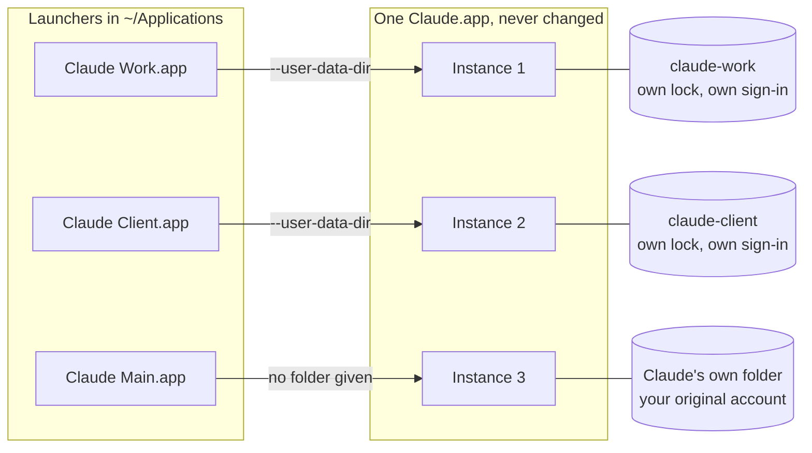

# aidentity guide

This is the full user guide for `aidentity`, a command-line tool that runs several accounts of the same Mac app at once, for apps built on Chromium or Electron. It describes version 1.6.1.

**On this page:** [Quick start](#quick-start) · [Install and upgrade](#install-and-upgrade) · [The problem](#the-problem) · [Which apps work](#which-apps-work) · [How it works](#how-it-works) · [Is this safe?](#is-this-safe) · [Signing in to a new profile](#signing-in-to-a-new-profile) · [Opening your original account](#opening-your-original-account-while-a-profile-runs) · [Dock tiles](#the-rough-edge-dock-tiles-show-the-original-app) · [Commands](#commands) · [Per-profile settings](#per-profile-settings) · [FAQ](#frequently-asked) · [Uninstall](#uninstall) · [Requirements](#requirements) · [Contributing](#contributing)

**Run several accounts of the same Chromium or Electron Mac app at the same time. Each one stays signed in, in its own window.**

macOS runs an app only once, so you get one account at a time. To check your personal Claude, you sign out of your work Claude. `aidentity` gives each extra account a small launcher and its own data folder. Together they make a *profile*. Your work, personal and client accounts then open side by side.

- **Verified with** Claude Desktop. Also tested with ChatGPT, Slack, VS Code, Cursor, Notion and other apps built on Chromium (the engine inside Google Chrome) or Electron. See [Which apps work](#which-apps-work).
- **Your real app is not changed.** It is never copied, patched or re-signed. See [Is this safe?](#is-this-safe)
- **One shell script** (a text file of Terminal commands). It makes no network calls except when you run `aidentity update`, never uses `sudo` (admin rights) and runs nothing in the background.
- **Set up once in Terminal.** After that, you open each account by clicking its icon, like any other app.

---

<a id="30-seconds"></a>

## Quick start

You need a Mac and the Terminal app. To open Terminal, press **Cmd + Space**, type `Terminal` and press **Return**.

**1. Install.** Paste this line into Terminal and press **Return**:

```bash
curl -fsSL https://raw.githubusercontent.com/PiniShv/aidentity/main/install.sh | bash
```

This puts one file, the `aidentity` command, on your Mac. It checks the download first. It never uses `sudo` (admin rights), it does not edit your shell settings, and it starts nothing in the background. Want to read it first, or use Homebrew? See [Install and upgrade](#install-and-upgrade).

**2. Say yes to the walkthrough.** The installer ends with `Set up your first extra account now? [Y/n]`. Press **Return**.

**3. Answer the questions.** For each yes/no question, press **Return** to take the suggested answer. Pick your app from the numbered list. Type a name for the account, for example `Work`. When it asks `Set up another account?` and you are done, type `n`.

**4. Open the new icon and sign in.** The walkthrough offers to open the `Applications` folder in your home folder. Double-click the new icon, for example `Claude Work`. It opens signed out. Sign in with your second account. You do this only once. Drag the icon to your Dock to keep it one click away.

> [!IMPORTANT]
> If the app is already open, quit it before you sign in to the new icon. Open your other window again afterwards. Some apps sign you in through your web browser, and macOS sends that sign-in back to the app window that started first. [More on this](#signing-in-to-a-new-profile).

That is it. Each window now keeps its own sign-in.

Not sure your app will work? This lists the apps on your Mac that can take extra accounts:

```bash
aidentity apps
```

Not sure what to type? [Build your recipe](https://aidentity.pinishv.com/recipes/). Pick your apps, name your accounts and choose their colours, and the page gives you the commands to paste. It runs in your browser and sends nothing anywhere. Prefer a menu to typing? After you install, [`aidentity ui`](#aidentity-ui) opens one in Terminal.

### What it looks like


<sub>The recording uses the direct commands from [Commands](#commands). `aidentity setup` does only the first part, creating profiles, and it asks you questions instead.</sub>

### What next?

| I want to... | Go to |
|---|---|
| Add another account, in this app or another one | [`aidentity add`](#aidentity-add) |
| Use a menu instead of typing commands | [`aidentity ui`](#aidentity-ui) |
| Open my original account while another one runs | [Opening your original account](#opening-your-original-account-while-a-profile-runs) |
| Tell the running windows apart | [The rough edge: Dock tiles](#the-rough-edge-dock-tiles-show-the-original-app) |
| Quit one account and leave the others open | [`aidentity quit`](#aidentity-quit) |
| Change a name or a colour | [`aidentity rename`](#aidentity-rename), [`aidentity set`](#aidentity-set) |
| Bring back an icon I deleted | [`aidentity restore`](#aidentity-restore) |
| Move my setup to another Mac | [`aidentity export`](#aidentity-export), [`aidentity import`](#aidentity-import) |
| Fix something that looks wrong | [`aidentity doctor`](#aidentity-doctor) |
| Remove one account, or everything | [`aidentity rm`](#aidentity-rm), [Uninstall](#uninstall) |
| Get data back that I removed | [Data in the Trash](#data-in-the-trash) |
| Upgrade aidentity | [`aidentity update`](#aidentity-update), [Install and upgrade](#install-and-upgrade) |
| See the options of one command | [`aidentity help`](#aidentity-version--aidentity-help) |
| Get tab completion | [`aidentity completion`](#aidentity-completion) |

---

## Install and upgrade

This page describes version 1.6.1. You need macOS and the `bash` that comes with it. See [Requirements](#requirements).

**Install script (recommended).** This is the line from the quick start. It installs into `/usr/local/bin`, or into `~/.local/bin` if it cannot write there. Terminal finds commands only in the folders on your `PATH` (a list of folders). If the new folder is not on it, the installer prints the line to add and leaves your shell files alone. It installs a fixed, numbered version (a release tag), not the newest code on `main`. At the end it offers to start the walkthrough.

<details>
<summary>Read the install script before you run it</summary>

```bash
curl -fsSLO https://raw.githubusercontent.com/PiniShv/aidentity/main/install.sh
```

```bash
less install.sh
```

```bash
bash install.sh
```

</details>

**Homebrew.** This uses a third-party tap (an extra package list that this project keeps), not homebrew-core, Homebrew's main list. `brew tap pinishv/tap && brew install aidentity` does the same in two steps.

```bash
brew install pinishv/tap/aidentity
```

Homebrew does not start the walkthrough, so run it yourself:

```bash
aidentity setup
```

Homebrew installs the latest release in the tap. It also installs [tab completion](#aidentity-completion) for bash, zsh and fish. Run `aidentity version` to see which release you have. Before 1.2.0, `restore`, `--main`, `--arg`, `--env`, `--own-extensions` and `doctor --fix` did not exist. `list --json` came in 1.3.0. `ui`, `update`, `completion` and the help for one command came in 1.4.0. `quit`, `export` and `import` came in 1.6.0. Before 1.6.0, `rm --purge`, `prune` and the uninstaller deleted profile data instead of moving it to the Trash. If you see an older version, upgrade.

<details>
<summary>Install from source</summary>

```bash
git clone https://github.com/PiniShv/aidentity.git
```

```bash
cd aidentity && make install
```

This copies the same single script to `/usr/local/bin`. If that folder is not writable, `make install` prints your options, for example `make install PREFIX=$HOME/.local`. It never runs `sudo` itself.

</details>

**Upgrade.** `aidentity` never checks for updates by itself. It looks for a new release only when you run `aidentity update`:

```bash
aidentity update --check   # is a newer release out? Installs nothing.
aidentity update           # install the latest release
```

`update` downloads the release from GitHub, checks it against the published checksum and replaces the script in one step. It never downgrades and never uses `sudo`. [What it checks, step by step](#aidentity-update). The command exists from version 1.4.0. If your copy is older, use one of the next two ways instead.

With Homebrew, let Homebrew do it. `aidentity update` leaves a Homebrew copy alone and tells you to use `brew upgrade` instead:

```bash
brew update && brew upgrade aidentity
```

With the install script, you can also run the install line again. It replaces the old version.

After any upgrade, launchers you built earlier keep working. `aidentity doctor` lists older ones, and `aidentity doctor --fix` brings them up to date.

To see what each way checks, read [What each install channel checks](#what-each-install-channel-checks).

---

## The problem

You have a work account and a personal account in the same app. Maybe a client account too. macOS runs that app only once, and the app remembers one signed-in session. To use the other account, you sign out and sign in again. You lose your open chats and your window layout. An hour later you do it all again the other way.

`aidentity` is for when you want the accounts open at once. Two or three windows sit side by side, and none of them signs the others out.

| Option | Good when | Downside |
|---|---|---|
| Sign out, sign in | You switch rarely. | One account at a time. You repeat the sign-in at every switch. |
| The app's own account switcher | The app has one, and one account at a time is enough. | Many apps have none. It is still one account at a time. |
| A browser profile with the web app | The web version is enough. | You get the web app, not the desktop app. |
| A copy of the app, signed again | Rarely. People try it to give the Dock tile a different name and icon. | A signature made on your Mac cannot match the maker's signature. The copy loses access to the keychain (where macOS keeps saved passwords and keys) and often will not start. |
| Typing the launch command yourself | You need it once. | It is the same mechanism, but you manage the folders, names and icons by hand. |
| **aidentity** | You want several accounts open at once. | macOS only. Chromium and Electron apps only. Running profiles share the app's Dock tile. |

Browsers such as Chrome and Edge have good built-in profiles. Use those first.

---

## Which apps work

An app can take extra accounts if it is built on **Chromium** or **Electron**. Chromium is the engine inside Google Chrome. Electron is a toolkit that builds desktop apps on that engine. `aidentity apps` shows which of your apps qualify.

| App | Works | Notes |
|---|---|---|
| Claude Desktop | Verified | `com.anthropic.claudefordesktop`. Use `--seed` to copy your MCP server config into the new profile. |
| ChatGPT | Tested | `com.openai.codex`. It looks native, but it is Chromium inside. |
| Slack | Tested | Slack's own workspace switcher covers most cases. Profiles are for separate *accounts*. |
| Visual Studio Code | Tested | Separate profiles get separate settings. Extensions are shared unless you use [`--own-extensions`](#per-profile-settings). Keep the profile name short: see below. |
| Cursor | Tested | A fork of VS Code, so the same applies. |
| Kiro | Tested | A fork of VS Code, so the same applies. |
| Antigravity | Tested | |
| Notion | Tested | |
| Notion Calendar | Tested | |
| Podman Desktop | Tested | |
| Postman | Tested | |
| Google Chrome | Detected | Chrome has built-in profiles. Use those first. |
| Microsoft Edge | Detected | Built-in profiles are the better tool here too. |
| Brave / Arc / Vivaldi / Comet | Detected | Browsers. Built-in profiles usually do the job better. |
| ChatGPT Classic | **No** | `com.openai.chat`. A native Swift app. See below. |

- **Verified** means two accounts were signed in at once, checked by hand.
- **Tested** means a second copy started next to the first and kept its data in its own folder. Signing in to two accounts has not been checked by hand yet.
- **Detected** means the app has the Chromium or Electron structure that `aidentity` looks for, but it has not been tested.
- **No** means it cannot work: the app is native, or it ignores the separate folder.

`aidentity apps` lists every app with the right structure, including the few that ignore the separate folder. If an app misbehaves, [open an issue](https://github.com/PiniShv/aidentity/issues) and the table gets fixed.

**VS Code, Cursor and Kiro: keep the profile name short.** These apps put a small connection file inside the profile folder, and macOS limits how long its path can be. With a long profile name, the app would quit right after it starts. `add`, `rename` and `restore` refuse a name that is too long and say how many characters to cut. `aidentity doctor` reports older profiles that are already too long; fix those with `rename`.

There is no list of apps in the code. `aidentity` looks at how each app is built: it looks for `Electron Framework.framework`, or for a framework with Chromium helper apps inside. `apps` and `setup` look in `/Applications` and `~/Applications`. For an app somewhere else, give `add` the path to the `.app`.

### Genuinely native apps do not work

Apps written in Swift or AppKit have no `--user-data-dir` option, because they have no Chromium inside to accept it. Without that option, `aidentity` has nothing to work with. **ChatGPT Classic** (`com.openai.chat`) is the example you are most likely to meet. The newer ChatGPT desktop app is Chromium inside, so `aidentity` can run it as a separate copy. The Classic one is native and cannot work.

`aidentity add` checks this first, refuses and explains why. It does not build a launcher that would quietly open a second window on the same account. Support for native apps is not planned for version 1.

---

## How it works

Chromium and Electron apps keep a lock inside their own data folder. The lock stops the app from starting a second time. A start-up option, `--user-data-dir`, tells the app to use a different data folder. With a different folder, the app never sees the first lock, so it simply starts. Each start is a separate *instance*: the same app, running again on its own. Nothing on disk is copied. Cookies and sign-in data live in that data folder, so each folder keeps its own account.

`aidentity` builds a **profile** for each extra account: a small launcher app and its own data folder. The launcher opens the app you already have, with that folder.



The launcher is a short shell script inside a small `.app` folder. Here it is, shortened. The real file has the code for the first two comments. You can read yours with `cat`, or in Finder with **Show Package Contents**.

```sh
#!/bin/sh
# Generated by aidentity 1.6.1. Safe to delete.
# 1. Drop risky variables (DYLD_*, LD_*, ELECTRON_*, NODE_*, ...) from the environment.
# 2. On a new profile's first open, warn if another instance of the app is already running.
# 3. Open the app again, with this profile's folder:
exec /usr/bin/env "$@" /usr/bin/open -na '/Applications/Claude.app' \
  --args --user-data-dir='/Users/you/Library/Application Support/aidentity/profiles/claude-work'
```

That `open -na` line is the whole mechanism. A launcher for your original account, made with `--main`, is the same line without `--user-data-dir`. The launcher holds the path to your app, not a copy of it. So when the app updates, the next launch uses the new version.

**Where things live** (defaults):

| What | Path |
|---|---|
| Launcher | `~/Applications/<App> <Profile>.app` |
| Data folder | `~/Library/Application Support/aidentity/profiles/<slug>/` |
| Restore record | `<data folder>/.aidentity-profile.plist` |

The slug is the launcher name in lower case, with spaces and underscores turned into hyphens. Other characters are dropped. `Claude Work` gets the folder `claude-work`. The restore record stores the profile's name, app, badge, colour and launch settings, so a lost launcher can be [restored](#aidentity-restore). The app ignores it.

By default, each launcher shows the app's own icon with a coloured circle and one letter. The letter and colour come from the name, so a profile always looks the same. The launcher has no Dock tile of its own.

---

## Is this safe?

`aidentity` is one shell script, about 5,600 lines of bash. It runs as you, with your own permissions. [Read it](../bin/aidentity) before you run it. The repository also keeps it in [`src/`](../src), split by subject into smaller files that are joined to make that one.

### What it touches

| What | What aidentity does | How to undo it |
|---|---|---|
| The `aidentity` command | Puts one file on your Mac: in `/usr/local/bin` or `~/.local/bin` with the install script, or where Homebrew keeps its commands. `aidentity update` replaces that file with a newer release, when you run it. | [Uninstall](#uninstall) |
| One launcher per profile | Builds a small app in `~/Applications`, for example `Claude Work.app`. It holds a script, an `Info.plist` with an `AIdentityProfile` marker, and an icon. It tells macOS about the new app so the icon shows at once. | `aidentity rm "Claude Work"` |
| One data folder per profile | Makes a folder under `~/Library/Application Support/aidentity/profiles/` that only you can open. The app keeps that account's sign-in there. `aidentity` adds one small restore record. | `aidentity rm "Claude Work" --purge`, or `aidentity prune`. Both move the folder to the Trash. |
| The Trash | `rm --purge`, `prune` and the uninstaller move a profile's data folder into the Trash, with a plain rename. They never empty the Trash, and never delete anything from it. | Move the folder back, then run `aidentity restore` (or `aidentity add`). [How](#data-in-the-trash) |
| A running app | `aidentity quit` asks one profile's copy of the app to quit, the way the app's Quit menu item does. It acts only on a copy that macOS knows as an app, and only on your own processes. It never stops a command-line tool. | Open the profile again. |
| A file for `import` | `aidentity import` reads the file you name and builds launchers from it, like `add`. It never changes a launcher that exists. | `aidentity rm "Claude Work"` for each one |
| Your real app | Read only. It looks at the app's `Info.plist`, its icon and its files, to check that it is a Chromium or Electron app. | Nothing to undo |
| Your original account | Never moved or changed. One exception: `--seed` reads Claude Desktop's `claude_desktop_config.json` and copies it into the new profile. | Nothing to undo |

One thing does change. While a profile is running, clicking the app itself switches to that profile. A Main launcher fixes this. See [Opening your original account](#opening-your-original-account-while-a-profile-runs).

### What it never does

- **Copy, patch or re-sign your app.** The app keeps its original signature, so its keychain access and its own updater keep working.
- **Touch a launcher it did not build.** Every launcher carries the `AIdentityProfile` marker. `open`, `rm`, `rename`, `set` and `rebuild` refuse an app without it. `add` and `restore` refuse to overwrite one.
- **Delete profile data.** `--purge`, `prune` and the uninstaller move a data folder to the Trash, where you can still get it back. Emptying the Trash is what deletes it. If the folder cannot be moved there, it stays where it was.
- **Touch profile data outside its profiles folder.** `--purge`, `prune` and the uninstaller move a data folder only if it is inside `~/Library/Application Support/aidentity/profiles`, or the folder set by `AIDENTITY_DATA_ROOT`.
- **Move or rename a profile's data while the profile is running.** If it cannot tell, it treats the profile as running and stops.
- **Use the network, except when you run `aidentity update`.** No telemetry, no analytics, no automatic update check, no crash reports. `aidentity update` (and `update --check`) is the only code in the script that connects anywhere, and only to GitHub. Apart from it, only the installer downloads anything, and only when you run it. [What `update` does](#aidentity-update).
- **Use `sudo` or run in the background.** It adds no login item, no launch agent and no daemon. These are ways macOS starts a program by itself, at login or in the background. When the installer, the uninstaller or `aidentity update` needs admin rights, it prints a `sudo` line for you to run.
- **Edit your shell files.** If you need a `PATH` line, the installer prints it, and you add it.
- **Control other apps.** It does not use System Events, so it needs no Accessibility permission. The one thing it does to a running app is `aidentity quit`, which asks that one app to quit, as its Quit menu item does. That needs no permission either.
- **Trust an import file.** `import` checks every value as `add` does, finds each app by its bundle ID among the apps installed here, ignores any path in the file, and shows what it will build, and asks before it builds anything. Only `-y` skips that question. A launcher that exists is skipped, never changed.
- **Handle your passwords.** You sign in inside the app, with that account's own details.

<details>
<summary>More guards in the code</summary>

| Guard | What it does |
|---|---|
| Safe rebuilds | A new launcher is built beside the old one, then swapped in. If that fails or you press Ctrl+C, the old one comes back. A failed `rename` moves the data back. |
| Owner-only files | New data folders, restore records, seeded config files and launchers with settings can be read only by you. `doctor` reports folders that other users can read. |
| Allowlist for settings | `--arg` and `--env` accept only a short list of switches and variables, each with a strict value shape. The check runs again on every build. |
| Clean start | Before it opens the app, the launcher drops `DYLD_*`, `LD_*`, `ELECTRON_*`, `NODE_*`, `VSCODE_*`, `CHROME_*`, `CHROMIUM_*` and `SSLKEYLOGFILE`. |
| Safe names | Profile names allow only ASCII letters, digits, spaces, hyphens and underscores. Every value in the launcher is quoted. The `Info.plist` must pass `plutil -lint`. |
| Restore record is checked | `restore` checks the record as if you had typed it: the name, the folder, the app and the settings. |
| Asks first | `rm`, `prune` and `import` ask you to type `yes` (`-y` skips this). The uninstaller asks you to type `delete`. |

</details>

### Check it yourself

In a clone of the repository, look for network tools and `sudo`:

```bash
grep -nwE 'curl|wget|nc|ncat|ssh|scp|sudo|telnet' bin/aidentity
```

This prints a short list. Only one line runs `curl`: the download in the function `https_fetch`, which only `aidentity update` calls. The other lines are comments, messages and help text that name `curl` or `sudo`, and one check that `curl` is installed. `make check` fails if another `curl` command appears in the script.

Check the script against its checksum (a fingerprint of the file):

```bash
shasum -a 256 -c SHA256SUMS
```

To check the file you installed, run this:

```bash
shasum -a 256 "$(command -v aidentity)"
```

Compare the long number it prints with the `bin/aidentity` line in `SHA256SUMS` for your version. For 1.6.1, that file is at <https://raw.githubusercontent.com/PiniShv/aidentity/v1.6.1/SHA256SUMS>. For another version, change `v1.6.1` in the address.

Releases from 1.4.0 on also carry signed build provenance: a record, signed by GitHub, of where a file was built. The four files on each [release page](https://github.com/PiniShv/aidentity/releases) (`aidentity`, `install.sh`, `uninstall.sh` and `SHA256SUMS`) have it. The release workflow makes it when a release tag is pushed. To check a file you downloaded, use the GitHub CLI. Install it with `brew install gh`, and sign in once with `gh auth login`, because the check reads the provenance from GitHub:

```bash
gh attestation verify aidentity --repo PiniShv/aidentity
```

A pass means a GitHub Actions run in this repository signed that exact file. It does not mean the code is safe: read the script for that. GitHub's "Source code" archives are not signed, and releases before 1.4.0 have no provenance. The install script, Homebrew and `aidentity update` do not run this check. [SECURITY.md](../SECURITY.md#verifying-a-release) says what a pass proves and what it does not, and gives the stricter command that also names the workflow and the tag.

Get a report of your setup. It changes nothing unless you add `--fix`:

```bash
aidentity doctor
```

### What each install channel checks

| Channel | What it checks | What it does not protect against |
|---|---|---|
| Install script | The download matches its checksum, and a release says it is that version. See the list below. | A hacked repository, because the checksum comes from the same place. |
| Homebrew | The formula pins the SHA-256 checksum of the release. Homebrew refuses a download that does not match. | It is a third-party tap, so you trust its owner. This is stronger than the install script. |
| `aidentity update` | The download uses HTTPS only, matches the release's checksum and says it is that release's version. See [What it checks](#aidentity-update). | A hacked repository, because the checksum comes from the same place as the script. |
| From source | You read what you build. `make install` copies one file. | Only what you skip reading. |

The install script checks the download like this, with the same code as `aidentity update`:

- It uses HTTPS only, and its own downloads do not read your `~/.curlrc`. (The `curl` you pipe into `bash` still reads it.)
- It downloads `SHA256SUMS` from the same ref as the script, and the file's SHA-256 checksum must match the line for `bin/aidentity`. If `SHA256SUMS` cannot be downloaded, has no such line, or does not match, it refuses to install, changes nothing and names the ref it tried (`AIDENTITY_REF`).
- For a release tag such as `v1.4.0`, the file must also say it is that version. A branch or a commit names no version, so the checksum alone decides.

So it catches a cut-off or damaged download. Each release is checked before it is published: the script must pass `bash -n` (a syntax check) and end on its normal last line.

`SHA256SUMS` lists only `bin/aidentity`. The installer and uninstaller have no checksum, so read them first if that matters to you.

### What is not protected

- **Profile data is not encrypted by `aidentity`.** Each data folder holds live sign-in cookies and tokens, just like the app's own folder. Your file permissions and FileVault (Apple's disk encryption) protect them, and nothing else. A second profile is a second live session on your disk. A folder in the Trash is the same: it keeps its live sign-in until you empty the Trash.
- **The launcher is not notarised.** Notarisation is Apple's check of software from a developer. Your launcher is built on your Mac. It gets a local signature if the Xcode Command Line Tools are installed, and none if they are not. It runs either way.
- **Only the latest release gets fixes.** There are no fixes for older versions.

To report a security problem privately, follow [SECURITY.md](../SECURITY.md). Please do not open a public issue for it.

---

## Signing in to a new profile

Some apps sign you in through your web browser. After you approve, the browser passes the result back to the app as a link. When several instances of one app run, macOS gives that link to the instance that started **first**. So if you sign in to a new profile while another instance is open, the sign-in can land in the wrong window.

To protect you, a new profile's launcher shows a warning when you open it for the first time while another instance of the app runs. Choose **Open Anyway** to go on, or **Cancel** to stop. If you cancel, it warns you again next time.

The safe order is:

1. Quit the other windows of that app.
2. Open the new profile and sign in.
3. Open the other windows again.

After that first sign-in, each profile stays signed in on its own. `add` and `setup` print the same advice when the app is already open.

---

## Opening your original account while a profile runs

macOS keeps one record per app, not one per window. Every profile is the same `Claude.app`, started again. So while any profile runs, macOS thinks Claude is running. If you click `Claude.app` in the Dock, in Finder or in Spotlight, macOS switches to the running app. You land in whichever profile is open, and your original account does not start.

The fix is a launcher for your original account. The walkthrough offers one after your first profile in an app. You can also build it yourself:

```bash
aidentity add Claude --main
```

This builds `~/Applications/Claude Main.app`. It starts Claude with no profile folder, so it opens the account that `Claude.app` always opened, with Claude's own data. It starts even while other profiles run. If your original account is already open, Claude passes the launch on to that open window. Pin it to your Dock instead of `Claude.app`.

From Terminal, `open -na /Applications/Claude.app` does the same thing.

A Main launcher never touches the app's data. `rm --purge` leaves it alone, and `rename` only renames the launcher. Each app can have one Main launcher.

---

## The rough edge: Dock tiles show the original app

This is the biggest cost. Know it before you start.

The launcher icon carries your profile's name and a coloured letter badge. That is what you see in Finder, and what you drag to the Dock. But while the app runs, the Dock shows the app's own tile. Its name and icon come from inside the app, and `aidentity` does not change the app. So two running Claude profiles both show a tile named "Claude", with Claude's icon.

How to tell them apart:

- **Look at the window.** Most of these apps show the signed-in account in the sidebar, the title bar or an avatar.
- **Give each profile a different badge colour.** The launcher icons in Finder, and the ones you pin to the Dock, stay different. So you always open the right one.
- **Use Mission Control** (swipe up, or press `Ctrl` + `Up`). It shows all windows at once, with their content.
- **Run `aidentity list`.** It shows which profiles are running.
- **Quit by name, not by tile.** `aidentity quit "Claude Work"` quits that profile's copy of the app, and no other. [More on `quit`](#aidentity-quit).

Changing the tile would mean copying the app and signing it again. That does not work. A copy signed on your Mac cannot match the maker's signature, so it loses keychain access and often will not start. Renaming a running instance from outside the app does not work either, because macOS ignores the change. So `aidentity` leaves your app alone and accepts an unclear Dock label.

---

## Commands

Type `aidentity` and a command. Put a name that has a space in quotes, like `"Claude Work"`. Type `aidentity` on its own to see the built-in help. For the options and examples of one command, type `aidentity help rm` or `aidentity rm --help`. [More on help](#aidentity-version--aidentity-help). The output is plain text for people. For scripts, [`list --json`](#for-scripts-list---json) prints the list as JSON. It was added in version 1.3.0. Colour is off when the output is not a terminal, or when `NO_COLOR` is set.

| Command | Also spelled | What it does |
|---|---|---|
| [`setup`](#aidentity-setup) | `init`, `wizard` | Guided walkthrough. Start here. |
| [`ui`](#aidentity-ui) | | A menu in your terminal: open, quit, add, rename, recolour or remove profiles with one key. |
| [`add [app]`](#aidentity-add) | | Create one profile directly. |
| [`list`](#aidentity-list) | `ls` | Show every profile and whether it is running. `--json` prints it for scripts. |
| [`open NAME`](#aidentity-open) | | Open a profile from Terminal. |
| [`quit NAME`](#aidentity-quit) | | Quit one profile's copy of the app. The other copies keep running. |
| [`rename OLD NEW`](#aidentity-rename) | `mv` | Rename a profile. It stays signed in. |
| [`set NAME`](#aidentity-set) | `modify`, `edit` | Change a profile's look or launch settings. |
| [`prune`](#aidentity-prune) | | Find data that no launcher uses, and offer to move it to the Trash. |
| [`restore [NAME]`](#aidentity-restore) | | Bring back a launcher that was deleted. |
| [`rebuild NAME`](#aidentity-rebuild) | `repair` | Rebuild launchers after an app moved or updated. |
| [`rm NAME`](#aidentity-rm) | `remove`, `delete` | Remove a launcher. The data stays unless you add `--purge`, which moves it to the Trash. |
| [`export`](#aidentity-export) | | Print every launcher as JSON, to build them again with `import`. |
| [`import FILE`](#aidentity-import) | | Build the launchers in a file that `export` made. |
| [`apps`](#aidentity-apps) | | List apps that can take extra accounts. |
| [`doctor`](#aidentity-doctor) | | Check the setup and every profile. `--fix` repairs what it can. |
| [`update`](#aidentity-update) | | Install the latest release. `--check` only looks. |
| [`completion SHELL`](#aidentity-completion) | | Print a tab-completion script for bash, zsh or fish. |
| [`version`, `help [COMMAND]`](#aidentity-version--aidentity-help) | `--version`, `-v`, `--help`, `-h` | Print the version, or the help of everything or of one command. |

### `aidentity setup`

The guided walkthrough, and the best place to start.

```bash
aidentity setup
```

It asks, in this order:

1. Whether to add a coloured badge to each icon, so you can tell them apart. The default is yes.
2. Which app needs another account. You pick from a numbered list. Type `q` to stop.
3. What to call the account, for example `Work`, `Personal` or `Client`.
4. For Claude Desktop only, and only if it finds your config file: whether to copy your MCP server config (the extra tools you connected to Claude) into the new profile.
5. After your first profile in an app: whether to add a `Main` launcher for your original account.
6. Whether to set up another account.

At the end it offers to open `~/Applications`, so you can drag the new icons to your Dock. If one profile fails, the walkthrough says so and continues.

It needs a terminal. In a script, use `add` with its options instead.

### `aidentity ui`

A menu in your terminal. It lists your profiles and whether each one is running. One key opens, quits, adds, renames, recolours, badges or removes the profile you select.

```bash
aidentity ui
```

```text
 aidentity 1.6.1                                   4 profiles · 1 running
 ──────────────────────────────────────────────────────────────────────
 ▸ ● Claude Work     [W]       running
   ○ Claude Personal [P]       in use
   ○ Claude Main     original  not running
   ○ Slack Client    [S]       signed out / new

 ↑↓ move  Enter open  s stop  a add  r rename  c colour  b badge
 d remove  x doctor  ? help  q quit
```

Each row is one launcher, the same ones `aidentity list` shows, with the same status words. `▸` marks the selected row, and a green `●` marks a profile that is running. The screen checks again every 2 seconds, so a profile that starts or stops shows up without a key press.

| Key | What it does |
|---|---|
| Up, Down (or `k`, `j`) | Move the selection. |
| Enter | Open the profile, like `aidentity open`. The result shows at the bottom of the screen: green when it worked, red when it failed. |
| `s` | Stop: quit this profile's copy of the app, like `aidentity quit`. The other copies keep running. The bottom of the screen says `Quitting NAME…` while it waits, which can take up to 10 seconds, and then shows the result. |
| `a` | Add a profile, like `aidentity add` with no options. You pick the app, then name the account. |
| `r` | Rename the account, like `aidentity rename`. It stays signed in. An empty answer cancels. |
| `c` | Change the colour, like `aidentity set --color`. Left and Right choose, Enter applies, Esc cancels. |
| `b` | Change the badge, like `aidentity set --badge`. It asks for one character. An empty answer cancels. |
| `d` | Remove, like `aidentity rm`. Then press `k` to remove the launcher and keep the data, or `p` to move the data to the Trash too. `p` asks you to type `yes` first. Any other key cancels. |
| `x` | Run `aidentity doctor` and show the report. Press `f` afterwards to run `doctor --fix`. |
| `?` | Show these keys. |
| `q`, Esc | Quit. Ctrl-D also quits. |

- **The keys run the normal commands.** The menu has no rules of its own, so every check is the one the command has. For example, a running profile cannot be renamed or removed. Questions and messages look as they do on the command line. Except for Enter and `s`, the menu steps aside while the command runs, asks you to press a key, and then draws itself again. When a command fails, its message shows in red, not green.
- **A Main launcher** (your original account) can be removed with `d` then `k`. `p` only tells you that `aidentity` never deletes the app's own data.
- **It needs a terminal.** Both input and output must be a terminal, and it must be able to move the cursor. If not, `aidentity ui` changes nothing and exits with an error. In a script, use [`list --json`](#for-scripts-list---json). It takes no options other than `--help`.
- **`aidentity` on its own still shows the help.** It does not open the menu.
- **It leaves your terminal as it found it.** The menu draws on a separate screen, like the one `less` uses, so your scrollback stays as it was. Quit with `q`. Ctrl-C and closing the window also put the terminal back. While a command waits for an answer, Ctrl-C only cancels that command and returns to the menu. Ctrl-Z puts the menu aside like any program, and `fg` brings it back and draws it again. Only a forced stop (`kill -9`) can leave the terminal in the menu's state; `reset` fixes that.
- **Limits.** The menu manages launchers only, like `list`. It does not show data folders or launch settings, and it has no keys for `rebuild`, `restore`, `prune`, `export`, `import` or `set --arg`. Use the commands for those. `s` has no way to force an app to quit: if the app is still running after 10 seconds, the menu says so, and you look at its window. There is no mouse support. Esc takes about a second to register, because an arrow key starts with the same key code. `q` is instant. A narrow window gets a shorter layout, and colour is off when `NO_COLOR` is set.

### `aidentity add`

Create one profile directly.

```bash
aidentity add                                                         # asks for the app and the name
aidentity add Claude --profile Work --color blue --seed               # no questions
aidentity add ChatGPT --profile Personal
aidentity add "/Applications/Visual Studio Code.app" --profile Client # an app given by its path
```

The app can be a name or a path. Names are not case-sensitive. Without an app or a `--profile`, `add` asks for them, so it needs a terminal.

| Option | What it does |
|---|---|
| `--profile NAME` | The account name, for example `Work`. Up to 40 characters: ASCII letters, digits, spaces, `-` and `_`. It cannot start or end with a space, and it cannot start with `-`. |
| `--badge X` | One character for the icon badge. Default: the first letter of the name. |
| `--color NAME` | `blue` `green` `orange` `purple` `teal` `pink` `red` `yellow` `gray` `graphite` (`grey` and `black` also work), or six hex digits such as `2E7DF6`, without `#`. Default: a colour picked from the name, so a profile always looks the same. |
| `--no-badge` | Use the app's own icon, unchanged, with your profile's name. |
| `--seed` | Claude Desktop only. Copy your `claude_desktop_config.json` (your MCP servers) into the new profile. After that, the two configs are separate. |
| `--main` | Build a launcher for your **original** account instead. It is named `<App> Main` unless you pass `--profile`. See [Opening your original account](#opening-your-original-account-while-a-profile-runs). |
| `--arg SWITCH` | Pass a start-up option (a *switch*) to the app every time. Repeat it for more. See [Per-profile settings](#per-profile-settings). |
| `--env NAME=VALUE` | Set an environment variable for this profile. Repeat it for more. |
| `--own-extensions` | VS Code and its forks only, such as Cursor and Kiro. Give the profile its own extensions folder. |

The launcher is named `<App> <Profile>`. For example, `aidentity add Claude --profile Work` makes `~/Applications/Claude Work.app`. That full name is what you give to `open`, `rename`, `set`, `rebuild`, `restore` and `rm`.

- Names that would share one data folder are refused. `Work 2`, `Work_2` and `Work-2` all clash.
- Run `add` again for a profile that exists, and it rebuilds the launcher. It keeps the badge, colour and settings unless you give new ones. It does not touch the data.
- `add` refuses while that profile is running.
- It refuses to overwrite anything at that path that `aidentity` did not create.

### `aidentity list`

Shows every profile, its app, where its data lives and whether it is running.

```bash
aidentity list
```

```text
Claude Work
   app      Claude
   profile  Work
   status   running
   data     /Users/you/Library/Application Support/aidentity/profiles/claude-work
```

The status is one of these:

- `running`: the profile is open now.
- `in use`: the profile has been opened before, but is not open now. This does not prove that the sign-in is still valid.
- `signed out / new`: the app has not saved anything in the profile yet.
- `running` or `not running`, for a Main launcher.
- `app missing`: the app has moved or is gone. The line shows the `rebuild` command that fixes it. If the app was uninstalled, reinstall it first.

`list` shows launch switches in full, and the *names* of variables, never their values.

#### For scripts: `list --json`

The plain list is for people, and its wording may change. A script, or another app that shows your profiles, should use `--json`. It prints the same profiles as one JSON array, with one object per launcher.

```bash
aidentity list --json
```

```json
[
  {"name":"Claude Work","app":"Claude","app_path":"/Applications/Claude.app","profile":"Work","data_dir":"/Users/you/Library/Application Support/aidentity/profiles/claude-work","main":false,"status":"running","badge":"W","color":"2E7DF6","built_by":"1.6.1","args":["--lang=de"],"env":["HTTPS_PROXY"],"own_extensions":false}
]
```

Every object has every key, in this order:

| Key | Value |
|---|---|
| `name` | The launcher's name. This is the name that `open`, `rename`, `set`, `rebuild` and `rm` take. |
| `app` | The app's name. |
| `app_path` | Where the app is. |
| `profile` | The profile name. |
| `data_dir` | The profile's data folder. `null` for a Main launcher. |
| `main` | `true` for a Main launcher, otherwise `false`. |
| `status` | One of the words above: `running`, `in use`, `signed out / new`, `app missing` or `not running`. |
| `badge` | The badge character. `null` when the launcher uses the app's own icon. |
| `color` | The badge colour: six hex digits, without `#`. |
| `built_by` | The `aidentity` version that built the launcher. |
| `args` | The launch switches, in full. |
| `env` | The *names* of the variables, never their values. |
| `own_extensions` | `true` when the profile has its own extensions folder. |

`app`, `app_path` and `built_by` are `null` if the launcher does not record them.

- Only JSON goes to standard output. Warnings go to standard error, and there is no colour, even in a terminal.
- With no profiles, it prints `[]`. It exits with 0.
- `list` refuses an option it does not know, so a mistyped `--json` fails instead of printing the plain list.
- `--json` was added in version 1.3.0. Older versions ignore it and print the plain list. Run `aidentity version` to see which one you have.

### `aidentity open`

Opens a profile from Terminal, instead of double-clicking it in Finder.

```bash
aidentity open "Claude Work"
```

### `aidentity quit`

Quits one profile's copy of the app. Every other copy keeps running.

```bash
aidentity quit "Claude Work"
```

While several profiles run, the Dock shows them as identical tiles, so it is hard to tell which one to quit. `quit` takes the launcher name that `aidentity list` shows. It finds the copy of the app that runs on that profile and asks only that copy to quit.

- **The app is asked the way its Quit menu item asks,** so it can still ask about unsaved work. This needs no permission. If the app turns the request down, it is sent SIGTERM, which these apps also treat as quit.
- **It acts only on a copy that macOS knows as a running app.** It never stops a command-line tool, even one that runs the app's own program, such as `code --wait`. If only such tools, or the app's helper processes, still use the profile, `quit` names them and exits with 1. `aidentity list` still shows the profile as running then.
- **It waits up to 10 seconds.** When the copy has quit, it prints `Quit Claude Work.` and exits with 0. If the app is still running by then, it says so and exits with 1. The app may be asking you something, so look at its window. There is no option to force a quit.
- **A profile that is not running** gives the message `'Claude Work' is not running.` and exit status 0.
- **A Main launcher** quits the copy on your original account.
- **It touches only that copy.** It looks at your own processes, and at the app's main process only: a helper process of the app, or a copy that runs on another profile, is never matched. It checks each process again right before it acts, because a process number can be reused once a process ends.
- It takes one name. In [`aidentity ui`](#aidentity-ui), the `s` key does the same.

### `aidentity rename`

Renames a profile. Its data moves with it, so the account stays signed in.

```bash
aidentity rename "Claude Work" Client
```

The second name is the new *account* name. The app name stays first. This example makes `~/Applications/Claude Client.app` and moves the data to `.../profiles/claude-client`. The data moves first and the launcher is rebuilt second. If the rebuild fails, or you interrupt it, the data moves back. A badge you picked by hand stays. A default badge follows the new name.

`rename` refuses while the profile is running, and when the new name is already taken.

### `aidentity set`

Changes a profile's badge, colour or launch settings, without touching its sign-in.

```bash
aidentity set "Claude Work" --color purple
aidentity set "Claude Work" --badge W
aidentity set "Claude Work" --no-badge
```

- `--color`, `--badge`, `--no-badge`, `--arg`, `--env` and `--own-extensions` take the same values as on `add`.
- `--clear-args` undoes `--arg`, `--clear-env` undoes `--env`, and `--shared-extensions` undoes `--own-extensions`.
- You must give at least one option.
- Only the launcher and its restore record are rewritten. The app's own data is never opened, so this is safe while the app runs.
- New launch settings apply the next time the profile opens.
- Asking for a colour on a launcher with no badge adds a badge back.

### `aidentity prune`

Finds profile data that no launcher points at, and offers to move it to the Trash.

```bash
aidentity prune
```

This data is left behind when you delete a launcher in Finder, or run `rm` without `--purge`. The folder stays, and it still holds a signed-in session. `prune` lists each folder with its size and full path, and marks the ones `restore` can bring back. Then it asks `Move N orphaned profile(s) to the Trash?` and waits for you to type `yes`. `-y` or `--yes` skips the question. With no terminal and no `-y`, it refuses and moves nothing. It skips anything that is running, and anything outside the profiles folder.

Each folder goes to the Trash, and `prune` prints where each one went. If a folder cannot be moved, `prune` says why, leaves that folder where it is, and exits with 1.

To undo, move a folder back into the profiles folder. If the list marked it `can be restored`, run `aidentity restore`. If it did not, run `aidentity add` with the same app and profile name: it uses the folder. [More on the Trash](#data-in-the-trash).

Before it calls a folder an orphan, `prune` looks for launchers in your launcher folder, in the app folders and through Spotlight. If you keep a launcher somewhere else, its data shows up in the list. Read the list before you type `yes`.

### `aidentity restore`

Rebuilds the launcher of a profile whose launcher is gone. The account opens again, still signed in.

```bash
aidentity restore                  # list what can be restored
aidentity restore "Claude Work"    # restore one
aidentity restore --all            # restore all of them
```

- `restore` reads the restore record in the data folder.
- If the app moved, it finds it again: first by name, then by bundle ID (the name macOS uses for an app, such as `com.anthropic.claudefordesktop`).
- It builds the launcher with the same look and settings. It checks everything in the record as if you had typed it.
- Profiles made before version 1.2.0 have no record yet. They get one the next time their launcher is rebuilt, and `aidentity doctor --fix` does that for you.
- A profile removed with `--purge`, or moved by `prune` or the uninstaller, is in the Trash. Move its folder back into the profiles folder first. `restore` then lists it again, if the folder holds a restore record. If it does not, run `aidentity add` with the same app and profile name: it uses the folder. [How](#data-in-the-trash). Once the Trash is emptied, the data and its record are gone.

### `aidentity rebuild`

Rebuilds launchers, for example after the app moved.

```bash
aidentity rebuild "Claude Work"    # one profile
aidentity rebuild --all            # every profile
```

- A launcher stores the path of its app. If that path is gone, `rebuild` looks the app up again by name. This covers a move between `/Applications` and `~/Applications`.
- If it still cannot find the app, it reports that profile, skips it and exits with an error.
- It also brings launchers built by an older version up to date.
- A launcher built by version 1.0.0 gets the default badge and colour. A letter or colour you picked by hand is lost. Set it again with `aidentity set`.
- Profile data is never touched, so every account stays signed in.

### `aidentity rm`

Removes a launcher. The data is kept by default.

```bash
aidentity rm "Claude Work"
```

It then prints how to bring the profile back (`aidentity restore "Claude Work"`) and how to move its data to the Trash (`aidentity prune`). If it cannot write a restore record, it prints the matching `aidentity add` line instead.

A Main launcher has no data, so `rm` only says that it removed the launcher. `restore` does not list a Main launcher. To get one back, run `aidentity add Claude --main`, with your own app's name.

To remove the launcher and move the profile's data to the Trash:

```bash
aidentity rm "Claude Work" --purge
```

```text
✓ Removed launcher 'Claude Work'.
✓ Moved the profile data to the Trash.
  It is now at: /Users/you/.Trash/claude-work
  To undo, move it back to: /Users/you/Library/Application Support/aidentity/profiles/claude-work
  then run:  aidentity restore "Claude Work"
```

> [!NOTE]
> `--purge` takes the account's cookies, sign-in and settings out of the profiles folder, so `aidentity` no longer has that account. Nothing is deleted yet: the data waits in the Trash, and the sign-in in it is still live. Anyone who uses your Mac as you can read it there. To undo this, move the folder back and run `aidentity restore`. To remove the data and the sign-in from this Mac, empty the Trash: then they are gone for good. If you need to cut access to the account, also sign out of its sessions on the vendor's site.

`rm` takes one name and asks you to type `yes`. Add `-y` or `--yes` to skip the question. It refuses while that profile is running. A Main launcher has no data of its own, so `rm` removes it even while the app runs. On a Main launcher, `--purge` does nothing, because `aidentity` never touches the app's own data.

#### Data in the Trash

`rm --purge`, `prune` and the uninstaller never delete profile data. They move the folder into the Trash, and tell you where it went.

- **To undo, move the folder back.** Open the Trash in Finder and drag the folder into the profiles folder. In Finder, **Go > Go to Folder** lets you paste a path. Use Finder because macOS may not let Terminal read the Trash. `rm --purge` prints the full path after `To undo, move it back to:`. `prune` prints the profiles folder. The uninstaller prints only where each folder went in the Trash. The target is always the profiles folder, and the folder keeps its own name, for example `claude-work`.
- **After the uninstaller, make the profiles folder first.** The uninstaller removes the profiles folder when it is empty, and the folder above it. Install `aidentity` again, then make the folder again. This is the default place. If you set `AIDENTITY_DATA_ROOT`, use that folder instead.

  ```bash
  mkdir -p ~/Library/Application\ Support/aidentity/profiles
  ```

- **Then bring the launcher back.** If the folder holds a restore record, run `aidentity restore`. `rm --purge` prints the line to use. If it holds no record, `restore` does not list it. Run `aidentity add` with the same app and profile name instead: it uses the folder.
- **The restore record is written first.** If the profile has no restore record yet (profiles made before 1.2.0 have none), `rm --purge` writes one before it moves the folder, so `restore` works after you move the folder back. `prune` and the uninstaller write none, so for an old profile use `add`. [More on this](#i-deleted-an-icon-by-mistake)
- **The name.** The folder keeps its name, for example `claude-work`. If the Trash holds a folder with that name already, the new one is called `claude-work 2`, then `claude-work 3`, and so on. If the name ends in a number, change it back to the plain name when you move it in, for example `claude-work`. `restore` accepts any folder name, but `add` uses only a folder named exactly like the profile.
- **One volume.** Each volume (a disk or a partition) has its own Trash. If the profiles folder is on your home volume, which is the default, the data goes to `~/.Trash`. If you moved it to another volume with `AIDENTITY_DATA_ROOT`, the data goes to a folder named with your user number (often `501`) inside the `.Trashes` folder of that volume. `.Trashes` must exist already: Finder makes `.Trashes` the first time you put something in the Trash from that volume. If it is not there, nothing is moved. The data stays where it was, and the message says why.
- **No copying.** `aidentity` renames the folder into the Trash, and never copies it across volumes. A rename happens whole or not at all. A copy that stops half way would leave half of the data in each place.
- **If it cannot move the data,** it says why and leaves the folder exactly where it was. `rm --purge` has already removed the launcher by then, so it prints where the data stayed and exits with 1. Run `aidentity restore` to bring the launcher back.
- **No Finder request.** `aidentity` moves the folder itself. It does not ask Finder to do it, which would need a permission prompt.
- **The sign-in stays live in the Trash.** A folder there holds the same cookies and tokens as before. Emptying the Trash is what deletes the data for good, and removes the sign-in from this Mac. `aidentity` never does that.

### `aidentity export`

Prints every launcher as JSON, so that `aidentity import` can build them again, on this Mac or another.

```bash
aidentity export > profiles.json
```

```json
{"aidentity_export": 1, "exported_by": "1.6.1", "launchers": [
  {"name":"Claude Work","app":"Claude","bundle_id":"com.anthropic.claudefordesktop","profile":"Work","main":false,"badge":"W","color":"2E7DF6","args":["--lang=de"],"env":["HTTPS_PROXY=http://proxy.example:8080"],"own_extensions":false}
]}
```

There is one object for each launcher, in the order that `aidentity list` shows them. Every object has every key, in this order:

| Key | Value |
|---|---|
| `name` | The launcher's name. It is there for the person who reads the file. |
| `app` | The app's name. Also only for reading. |
| `bundle_id` | The app's bundle ID. `import` finds the app by this alone. An empty string when it is not known: `import` skips that launcher. |
| `profile` | The profile name. |
| `main` | `true` for a Main launcher, otherwise `false`. |
| `badge` | The badge character. An empty string when the launcher uses the app's own icon. |
| `color` | The badge colour: six hex digits, without `#`. |
| `args` | The launch switches, in full. |
| `env` | The launch variables, each as `NAME=value`. The values are in the file. |
| `own_extensions` | `true` when the profile has its own extensions folder. |

- **No account goes with the file.** It holds no cookies, no sign-in and no app data. It holds no data folder and no other path. A profile you import starts signed out.
- **Keep the file private.** It holds the launch settings in full, and the values of the variables. A proxy setting can carry a password. `export` says so on standard error when the file holds variable values, or a switch with `@` in it, as in `user:password@`. No warning does not make the file safe to share, so read it first.
- Only the JSON goes to standard output, so `> profiles.json` saves just the file. Warnings go to standard error.
- In a launcher's object, a value is text, `true` or `false`, or a list of text. It is never `null`.
- With no launchers, it prints the same object with an empty `launchers` list, and exits with 0.
- If a launcher's app is gone, `export` takes the bundle ID from the profile's restore record. If there is no record either, it warns on standard error that `import` will skip that launcher, and `bundle_id` is empty.
- `exported_by` is the version of `aidentity` that made the file. `aidentity_export` is the format number. `import` reads format 1.
- It takes no options other than `--help`.

### `aidentity import`

Builds the launchers in a file that `aidentity export` made.

```bash
aidentity import profiles.json
aidentity import profiles.json --yes   # no question
```

Before it builds anything, it shows the plan and asks you to type `yes`:

```text
The launchers in profiles.json:

  create  Claude Work
          flags  --lang=de
          proxy  HTTPS_PROXY=http://proxy.example:8080
  skip    Claude Client — already exists
  skip    Slack Client — no app with the bundle ID com.tinyspeck.slackmacgap is installed

Create 1 launcher? Type yes to confirm:
```

Then it builds each launcher as `add` would, says what it made, and prints a count: `1 created, 2 skipped, 0 failed.` It exits with 1 if a build failed.

- **The file is not trusted.** It may come from someone else. `import` reads it once as JSON, with the JavaScript engine that comes with macOS. It refuses, with nothing changed, a file that is not valid JSON (a property list in any form is refused too), holds a `null`, is bigger than 4 MB, lists more than 200 launchers, or is not a format 1 file from `export`.
- **Every value is checked as `add` checks it:** the profile name, the colour, the badge, each switch and each variable (the [allowlist](#per-profile-settings) applies), and the bundle ID.
- **The app is found by its bundle ID,** among the apps installed here: the ones `aidentity apps` lists. A path in the file is never used. Install your apps first.
- **A bad or unknown entry is skipped,** with a one-line reason. The other entries go on. An entry is also skipped when its launcher exists already (it is never changed), when two entries would build the same launcher, and when its profile would share a folder with another launcher or a second Main launcher would be made for one app.
- **The name is built, not copied.** The launcher is named `<App> <Profile>`, as `add` names it, whatever the file calls it.
- **Profiles start signed out.** The one exception: if the data folder for that name is still here, `import` uses it, as `add` does, and the plan says so. That account may be signed in.
- **Check the launch settings.** They come from the file. The plan shows each new launcher's switches in full. For a variable it shows the name only, except a proxy variable such as `HTTPS_PROXY`: for that it shows the server, without any user name or password. A proxy setting sends that profile's traffic through the server it names. When the file is from someone else, read the plan, and also open the file in a text editor to read the values of the variables.
- `-y` or `--yes` skips the question. With no terminal and no `-y`, `import` refuses with `Nothing to confirm with.` and builds nothing. If you answer anything but `yes`, nothing is built.
- A file with no launchers in it prints `Nothing to do.` and exits with 0.

### `aidentity apps`

Lists the apps in `/Applications` and `~/Applications` that can take extra accounts, with their bundle IDs (the name macOS uses for an app).

```bash
aidentity apps
```

### `aidentity doctor`

Checks the setup, then every profile. Run it first when something looks wrong. If you report a bug, paste its output.

```bash
aidentity doctor
```

The output shows your Mac user name (inside folder paths) and the name of every profile. Before you paste it into a public issue, remove anything you want to keep private.

At the top it shows your macOS version, the `aidentity` version and the bash version. It shows whether the launcher folder can be written to. The `codesign` row shows whether the Xcode Command Line Tools are installed. It also counts the compatible apps and the profiles. Then it prints a tick for each healthy profile and one line for each problem. It reports:

- a launcher built by an older version, or one with its script or restore record missing
- an app that moved, is gone, or no longer looks like Chromium or Electron
- a data folder that is missing, outside the profiles folder, shared with another launcher, or readable by other users
- data folders with no launcher

The last line counts the problems, and says how many `--fix` can repair.

```bash
aidentity doctor --fix
```

`--fix` repairs what needs no decision from you. It rebuilds out-of-date launchers, which also writes missing restore records. It makes data folders readable by you only. It never reads or changes the account data inside a folder. Problems that need your decision stay on the list, such as a deleted app.

`doctor` always exits with success, so a script can read its report. `doctor --fix` exits with an error if something it tried to fix could not be fixed.

### `aidentity update`

Installs the latest release in place of the copy you run. Nothing else in `aidentity` uses the network, and `update` does so only when you run it.

```bash
aidentity update --check   # is a newer release out? Installs nothing.
aidentity update           # install the latest release
```

There are no other options. It needs `curl` and `shasum`, which come with macOS. It never asks a question, so it also works in a script, and it prints each step it takes. It exists from version 1.4.0.

```text
Checking for the latest release of aidentity …
Downloading aidentity 1.6.1 …
  checksum verified
Installing to /usr/local/bin/aidentity …
✓ Updated 1.6.0 → 1.6.1
   /usr/local/bin/aidentity

Your launchers keep working. To rebuild them with the new version, run:
  aidentity doctor --fix
```

What it does, in order:

1. **Finds the file it runs from.** It follows links to the real file. It stops at once, before any network call, when that file is not its to replace:
   - A Homebrew copy: it prints `brew upgrade aidentity`.
   - A copy inside a clone of the repository: it prints the `git pull` line to use. Inside unpacked source code with no `.git`, it says to download the new release from GitHub.
   - A script that was piped into `bash`: it asks you to run it by its full path.

   With `--check`, it still asks GitHub, and then prints the command to use for your kind of copy.
2. **Asks GitHub for the latest release** and reads its tag. The tag must be a plain version number such as `v1.4.0`.
3. **Compares versions as numbers.** If you are up to date, it says so. If your copy is newer than the latest release, it says that and changes nothing. It never downgrades.
4. **Checks that it can write to the folder.** If not, it stops and prints a line for you to run, for example `sudo /usr/local/bin/aidentity update`. `aidentity` never runs `sudo` itself.
5. **Downloads two files over HTTPS:** `bin/aidentity` and `SHA256SUMS` of that release.
6. **Checks the download.** All of these must pass, or nothing is installed. `SHA256SUMS` must have a valid line for `bin/aidentity` (no checksum, no update), the file's SHA-256 must match it, and the file must say that it is the version of the tag. The checksum proves the file is the published one, so a damaged or cut-off download fails it. Each release is checked before it is published: the script must pass `bash -n` (a syntax check) and end on its normal last line.
7. **Replaces the old file in one step.** It writes the new file beside the old one, then moves it into place. A failed update leaves the old file exactly as it was.

Afterwards, your launchers keep working. To rebuild the ones made by an older version, run `aidentity doctor --fix`.

`--check` looks only at the release tag, so it downloads no script. It exits with 0 when you are up to date, and also when a newer release is out. A non-zero status means an error, for example no network. `update` exits with 0 when it updated or had nothing to do, and with an error when it refused or failed.

Good to know:

- **It contacts two hosts:** `api.github.com`, to read the tag, and `raw.githubusercontent.com`, to download the files (not with `--check`). It sends nothing about your profiles or your apps, only what any HTTPS request sends, such as your IP address.
- **It does not read your `~/.curlrc`,** so a setting there cannot turn off certificate checks. If you reach the internet through a proxy, set it in the environment, for example `https_proxy=http://proxy.example:8080`.
- **GitHub limits how many requests one IP address can make without signing in.** If you hit the limit, `update` fails and changes nothing. Try again later.
- **The checksum comes from the same repository as the script.** It catches a damaged, cut-off or swapped download, but not a compromise of the repository itself. The Homebrew formula pins a checksum reviewed at release time, so Homebrew is the stronger channel. For the signed provenance of a release file, see [Check it yourself](#check-it-yourself).

[SECURITY.md](../SECURITY.md) lists the same checks, and what is in and out of scope.

### `aidentity completion`

Prints a tab-completion script for bash, zsh or fish. It writes the script to standard output and changes nothing on your Mac.

```bash
aidentity completion zsh
```

Press Tab to complete command names, each command's options, the names of your profiles for `open`, `quit`, `rename`, `set`, `rebuild` and `rm`, the profiles whose launcher is gone for `restore`, app names for `add`, and colour names after `--color`. A name with a space is escaped for you.

**Homebrew** installs the scripts for all three shells. If completion does not work yet, follow [Homebrew's shell completion steps](https://docs.brew.sh/Shell-Completion) once.

**Other installs:** add one line to your shell's start-up file, then open a new Terminal window.

For bash, add this to `~/.bashrc`:

```bash
eval "$(aidentity completion bash)"
```

For zsh, add this to `~/.zshrc`, after the line that runs `compinit`:

```bash
eval "$(aidentity completion zsh)"
```

For fish, add this to `~/.config/fish/config.fish`:

```fish
aidentity completion fish | source
```

- Each Tab runs `aidentity` to find what fits, so a new profile shows up at once.
- It offers the long spellings of options (`--profile`, not `-p`). Short ones still work when you type them. Values for `--profile`, `--badge`, `--arg` and `--env` are not completed.
- The line above runs `aidentity` each time a new shell starts, which takes about a tenth of a second. You can instead save the output once as a file your shell reads, for example `aidentity completion fish > ~/.config/fish/completions/aidentity.fish`. The file holds no list of commands, so it stays right after an upgrade. Only a file saved from 1.4.0 must be made once more to show newer commands.
- It needs `aidentity` on your `PATH`.

### `aidentity version` / `aidentity help`

```bash
aidentity version
aidentity help
aidentity help rm
aidentity rm --help
```

`aidentity --version` and `aidentity -v` also print the version. `aidentity --help`, `aidentity -h` and `aidentity` on its own show the overview of every command. An unknown command prints the overview and exits with an error.

**Help for one command.** `aidentity help rm` and `aidentity rm --help` print the same page: how to use the command, each option with a short meaning, and examples. `-h` works too. Every command and every spelling has a page, for example `aidentity ls --help`.

- `--help` or `-h` anywhere after a command shows its help and does nothing else. `aidentity rm "Claude Work" --purge --help` removes nothing.
- `aidentity -h rm` shows the overview, not the help of `rm`, because `-h` comes first. Use `aidentity rm -h` or `aidentity help rm`.
- `aidentity help` with a name that is not a command prints a message and exits with an error.

### Environment variables

An environment variable is a named setting you put in front of a command. You do not need any of these for normal use.

| Variable | Used by | Default and effect |
|---|---|---|
| `AIDENTITY_APP_DIRS` | `aidentity`, uninstaller | `/Applications:$HOME/Applications`. Colon-separated folders searched for compatible apps. The uninstaller looks here for launchers. |
| `AIDENTITY_APPS_DIR` | `aidentity`, uninstaller | `~/Applications`. Where launchers are written, and where the uninstaller looks for them. |
| `AIDENTITY_DATA_ROOT` | `aidentity`, uninstaller | `~/Library/Application Support/aidentity/profiles`. Where profile data lives. |
| `NO_COLOR` | `aidentity`, installer, uninstaller | Any non-empty value turns colour off. |
| `AIDENTITY_INSTALL_DIR` | installer, uninstaller | Install into this folder instead of `/usr/local/bin` or `~/.local/bin`. The uninstaller looks here for the command. |
| `AIDENTITY_REF` | installer | The branch, tag or commit to install. Default: the release tag named in the script. |
| `AIDENTITY_BIN_DIRS` | uninstaller | Colon-separated folders to look in for the command, instead of the usual places. |

`AIDENTITY_APP_DIRS` and `AIDENTITY_APPS_DIR` differ only by where the `S` sits, and they mean different things. `APP_DIRS` is where your *apps* are searched for. `APPS_DIR` is where `aidentity` *writes* its launchers.

---

## Per-profile settings

Most people never need this. A profile can carry a few launch settings of its own, such as a proxy for a client's network, a language or a display scale:

```bash
aidentity add Claude --profile Client --arg --proxy-server=socks5://127.0.0.1:1080
aidentity set "Claude Client" --arg --lang=de --env HTTPS_PROXY=http://proxy.example:8080
aidentity add "Visual Studio Code" --profile Client --own-extensions
```

Only an *allowlist* (a fixed list of what is permitted) gets through. A launcher is one click for anyone at your Mac. Many switches and variables can hand the app to another program, or switch off its protections.

| Setting | Accepted values |
|---|---|
| `--proxy-server`, `--proxy-bypass-list` | A proxy value: up to 512 characters from `A-Za-z0-9:/._;=*,<>@+-` |
| `--no-proxy-server`, `--disable-gpu`, `--disable-lcd-text` | No value |
| `--lang`, `--locale` | A language tag, like `de` or `pt-BR` |
| `--force-device-scale-factor` | A number from 0.5 to 4 |
| `HTTP_PROXY`, `HTTPS_PROXY`, `ALL_PROXY`, `NO_PROXY`, and the same names in lower case | A proxy value |
| `LANG`, `LC_ALL`, `LC_CTYPE`, `LC_MESSAGES` | A locale, like `de_DE.UTF-8` |
| `TZ` | A time zone, like `Europe/Berlin` |

Anything else is refused. The same check runs again on `rebuild`, `rename`, `restore`, `set` and `doctor --fix`. A stored setting that is no longer allowed is dropped with a note, and never passed on.

Settings are stored in the launcher and in the restore record. A launcher with settings can be read only by you, but it is still a plain file. **Do not put passwords in launch settings.** `aidentity list` prints switch values in full, so a proxy address with a password in it would show.

VS Code and its forks keep extensions outside the data folder, so by default every profile shares yours. `--own-extensions` gives the profile its own `extensions` folder inside its data folder. `aidentity` recognises VS Code and its forks, such as Cursor and Kiro, by their `product.json` file.

---

## Frequently asked

### Something went wrong. Where do I start?

Run `aidentity doctor`. It checks your setup and every profile, and prints what is wrong. If it says problems can be fixed, run `aidentity doctor --fix`.

Still stuck? [Open an issue](https://github.com/PiniShv/aidentity/issues) and paste the output of `aidentity doctor`. For a problem with one app, add the output of `aidentity apps`. These outputs can show your Mac user name, your profile names and your apps. Remove anything you want to keep private first.

### Terminal says `command not found: aidentity`

The installer put the command in a folder that Terminal does not search yet. The installer printed a line to add to your shell settings file. If you no longer have it, this is the line for the usual case: the command in `~/.local/bin`, and zsh, the Mac's default shell.

```bash
echo 'export PATH="$HOME/.local/bin:$PATH"' >> ~/.zshrc
```

Then open a new Terminal window, or reload the file:

```bash
source ~/.zshrc
```

For bash, use `~/.bash_profile` in place of `~/.zshrc`. For fish, run `fish_add_path ~/.local/bin` instead. Until then, you can run the command by its full path, for example `~/.local/bin/aidentity`.

### Can I use more than two accounts?

Yes. `aidentity` has no limit. Run `add` once per account. Each one gets its own folder and its own lock. Give each one a different colour, so the icons are easy to tell apart. The real limit is memory, because every running profile is its own instance of the app.

### Does it break auto-update?

No. Your app updates itself as it always did. It is still the same untouched app in `/Applications`, and `aidentity` does not touch its updates.

### Does aidentity update itself?

Not on its own. It never checks for updates by itself, and it makes no network calls except when you run `aidentity update`. Run `aidentity update --check` to see whether a newer release is out, and `aidentity update` to install it. With Homebrew, use `brew upgrade aidentity`. See [Install and upgrade](#install-and-upgrade).

### What happens when the app updates?

Nothing for you to do. A launcher stores the *path* to the app, not a copy, so the next launch uses the new version. The one case that needs help is when the app *moves*, for example when you reinstall it into `~/Applications` instead of `/Applications`. Then run `aidentity rebuild --all`.

### Does a new profile start signed in?

No. A new profile starts with an empty folder, so you sign in once with that account's own details. `aidentity` does not copy, move or read your existing sign-in. The one exception is `--seed`, which copies Claude Desktop's MCP server config.

### Why do both running Dock tiles show the same app name and icon?

The name and icon live inside the app, and `aidentity` does not change the app. Only the launcher carries your profile's name and badge. See [The rough edge](#the-rough-edge-dock-tiles-show-the-original-app) for how to tell the windows apart.

### What happens when I click a profile that is already open?

Its launcher starts the app again with the same folder. The app sees its own instance running and passes the click on to it. That window comes forward. If you had closed its window, it opens again.

### Clicking Claude.app opens one of my profiles, not my original account

macOS sees every profile as Claude itself, so it switches to whichever one is running. Use `aidentity add Claude --main`. See [Opening your original account](#opening-your-original-account-while-a-profile-runs).

### I deleted an icon by mistake

Run `aidentity restore`. It lists the profiles whose launcher is gone. Their data is still there, so the restored icon opens the same account, signed in.

If a profile you expect is not in the list, it may be older than version 1.2.0 and have no restore record. Run `aidentity add` again with the same app and the same account name. It uses the same folder again.

If you removed the profile with `--purge`, its data is in the Trash, not in the list. See the next question.

### I used `--purge` by mistake. Can I undo it?

Yes, as long as you have not emptied the Trash. `rm --purge`, `prune` and the uninstaller move the data to the Trash. They do not delete it. The command printed where the folder went in the Trash. Move it back into the profiles folder, then run `aidentity restore "Claude Work"`, with your own profile's name. The account opens again, still signed in. After the uninstaller, make the profiles folder first. For a folder from `prune` or the uninstaller that has no restore record, use `aidentity add` with the same app and profile name. [The steps](#data-in-the-trash). Before version 1.6.0, these commands deleted the data. If you ran one with an older version, the data is gone.

### Does it work with Claude Code or other command-line tools?

No, and it does not need to. `aidentity` works on desktop apps. Command-line tools keep their sign-in in other ways, and many have their own way to use several accounts.

One related point. Claude Desktop keeps its MCP server list inside the data folder, so a new profile starts with none. `--seed` copies your config across as a starting point. After that, the two are separate.

### Is this against the terms of service?

`aidentity` creates separate local data folders and passes a documented command-line option. It does not get around sign-in, share credentials, bypass licences or change the app. You still sign in to each account normally, with its own details. Terms differ by product and plan, and some limit how many devices or sessions one seat may use. Check the terms of the plans you use. This is not legal advice.

### Both accounts are on the same plan. Do I need two subscriptions?

That is between you and the vendor. It depends on whether you have two separate accounts, which usually pay separately, or one account used twice. `aidentity` does not change what you may use. It changes how many windows you can have open.

### How do I move my profiles to a new Mac?

`aidentity` moves the setup, not the accounts. On the old Mac, save every launcher's recipe in a file:

```bash
aidentity export > profiles.json
```

Copy `profiles.json` to the new Mac. Install `aidentity` and the same apps there, then run:

```bash
aidentity import profiles.json
```

It shows what it will build and asks you to type `yes`. Each launcher comes back with the same app, profile name, badge, colour and launch settings. Open each one and sign in again: the file holds no account data and no folder paths, so every profile starts signed out.

`import` does not copy your Claude Desktop MCP server list. On the new Mac, run `aidentity add Claude --profile Work --seed` for each profile that needs it, with your own profile name. It keeps the badge, colour and settings.

The file holds your launch settings in full, and a proxy setting can carry a password. Keep the file private, and delete it when you are done. [More on `export`](#aidentity-export) and [`import`](#aidentity-import).

### How do I remove everything?

Use the uninstaller. It removes the launchers and moves the profile data to the Trash. See [Uninstall](#uninstall).

---

## Uninstall

`aidentity` has no uninstall command. The uninstaller script removes everything it made, in one go. It is a plain script, like the installer. Download it, [read it](../uninstall.sh) if you like, then run it in Terminal:

```bash
curl -fsSLO https://raw.githubusercontent.com/PiniShv/aidentity/main/uninstall.sh
```

```bash
bash uninstall.sh
```

What it does:

1. **Removes the command, without asking.** It looks in the usual install folders and wherever your `PATH` finds it. It leaves a Homebrew install and a repository checkout alone, and tells you so. If it cannot delete the file, it prints a `sudo rm -f` line for you to run. It never runs `sudo` itself.
2. **Lists everything else, with sizes.** That means every launcher that carries the marker, and every data folder, including data that no launcher points at any more.
3. **Stops if any listed profile is running.** The command is already gone by then, so quit that app yourself, for example with **Cmd + Q** in its window. Then run the script again.
4. **Removes only after you type `delete`.** It deletes the launchers and moves the profile data to the Trash. Any other answer keeps your launchers and data. They keep working without the command.

The data waits in the Trash, so you can undo a mistake. The uninstaller also removes the profiles folder when it is empty, so make that folder again first. To undo, install `aidentity` again, make the profiles folder, and move the folders back from the Trash. Then run `aidentity restore`. For a profile with no restore record, run `aidentity add` with the same app and profile name instead. [The steps](#data-in-the-trash). Once you empty the Trash, the data is gone for good.

It removes launchers only if they carry the marker, and moves data only from inside the profiles folder. For a Main launcher, it removes the launcher and keeps the app's own data. A Main launcher is not in the Trash: build it again with `aidentity add <App> --main`. macOS keeps Dock tiles after an app is gone, so drag the old ones out yourself.

<details>
<summary>Remove everything by hand</summary>

Do these steps in order, one block at a time. Quit every profile first.

1. See what exists:

   ```bash
   aidentity list
   ```

2. Remove each launcher that `list` shows, Main launchers too. Run this once for each one, with its own name. `--purge` also moves the profile's data to the Trash:

   ```bash
   aidentity rm "Claude Work" --purge
   ```

3. Move data that no launcher points at to the Trash:

   ```bash
   aidentity prune
   ```

4. Remove the command. If you installed with Homebrew:

   ```bash
   brew uninstall aidentity
   ```

   If you installed with the script or with `make`:

   ```bash
   rm -f "$(command -v aidentity)"
   ```

5. Remove the empty data folders. `rmdir` deletes a folder only if it is empty, so it stops if anything is left in it:

   ```bash
   rmdir ~/Library/Application\ Support/aidentity/profiles ~/Library/Application\ Support/aidentity
   ```

   If you set `AIDENTITY_DATA_ROOT`, use that folder instead.

   If `rmdir` says `Directory not empty`, look inside with `ls -A`. A file named `.DS_Store` is only Finder's view settings. Delete it, then run `rmdir` again:

   ```bash
   rm -f ~/Library/Application\ Support/aidentity/profiles/.DS_Store
   ```

   Any other file or folder is profile data that is still there. Move it to the Trash, or leave it.

Nothing here deletes profile data: it all goes to the Trash. Empty the Trash when you are sure you do not need it.

`command -v` finds the command wherever the installer put it. `brew uninstall aidentity` leaves launchers and profiles alone. `make uninstall` removes only the command. Nothing else was installed, so nothing else needs removing, and your real apps are as they were.

</details>

---

## Requirements

- **macOS.** There is no Linux or Windows version. No minimum macOS version is set. `aidentity doctor` shows yours.
- **The `bash` that comes with macOS** (version 3.2). You do not need a newer one.
- **Tools that come with macOS**, such as `PlistBuddy`, `plutil`, `iconutil`, `osascript` and `open`. It uses no Python, Node, Perl or `jq`.
- **Optional: the Xcode Command Line Tools.** Without them, launchers are unsigned. They still run. The tools also provide `strings`, which `add` uses for a slower, deeper check of an app with an unusual layout. `aidentity doctor` shows how to install the tools.
- **To install or update:** `curl` and `shasum` for the install script and for `aidentity update`, or `git` and `make` for a source install. `aidentity ui` needs a terminal.

---

## Contributing

Issues and pull requests are welcome at <https://github.com/PiniShv/aidentity>.

The most useful help is a report on one specific app: which app, which version, and whether two accounts stayed signed in at once. That is how rows in the table move to "Verified". For a bug, paste the output of `aidentity doctor`, with private details removed.

If you change code, read [CONTRIBUTING.md](../CONTRIBUTING.md) first. In short:

- The script targets bash 3.2, so no associative arrays, no `${var^^}` and no `mapfile`.
- It has no third-party dependencies. It uses only tools that come with macOS, plus the optional Xcode Command Line Tools.
- Tests set `AIDENTITY_APPS_DIR`, `AIDENTITY_DATA_ROOT` and `AIDENTITY_APP_DIRS`, and point `HOME` at their sandbox, so they never touch a real setup or the real Trash.
- `make check` runs the lint, the tests and the source checks.
- The code is written in `src/`. After a change there, run `make build`: it rebuilds `bin/aidentity` and `SHA256SUMS`. Commit all three.

Please follow the [Code of Conduct](../CODE_OF_CONDUCT.md). Release notes are in the [changelog](../CHANGELOG.md). For security reports, see [SECURITY.md](../SECURITY.md).

## Licence

MIT. See [LICENSE](../LICENSE).

Built by [Pini Shvartsman](https://pinishv.com).
